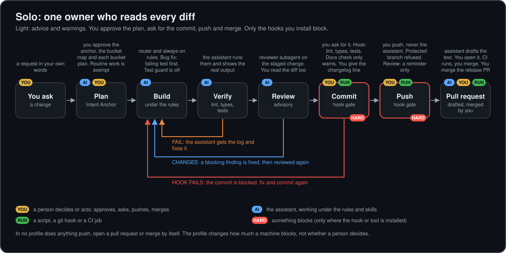
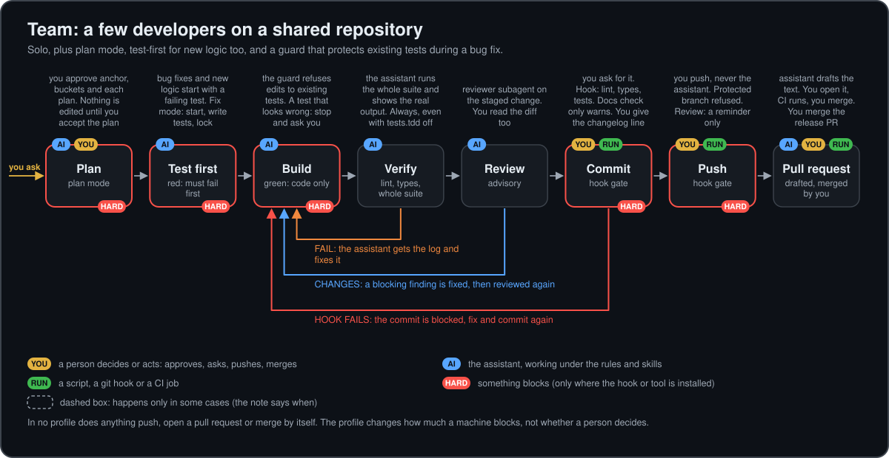
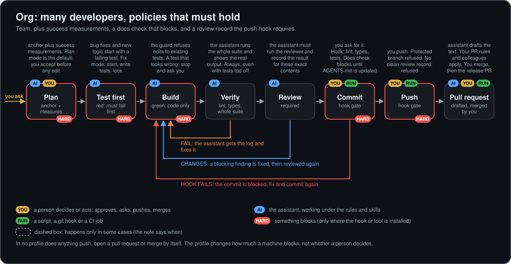
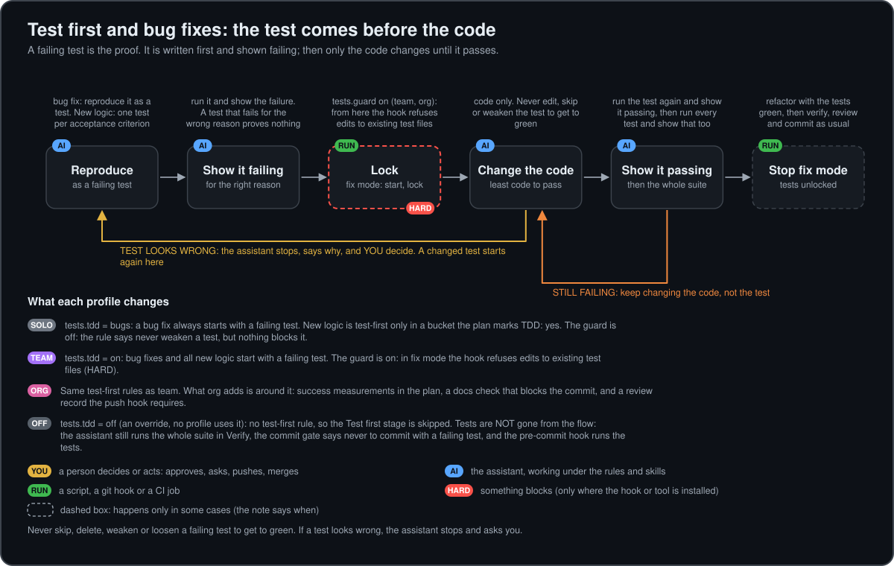
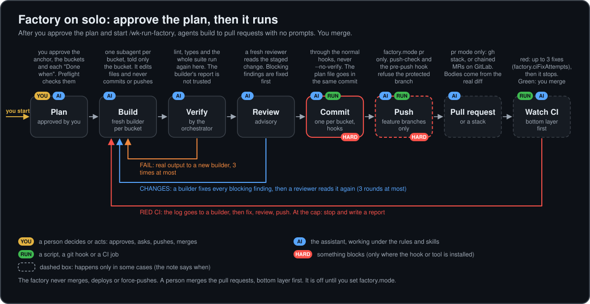
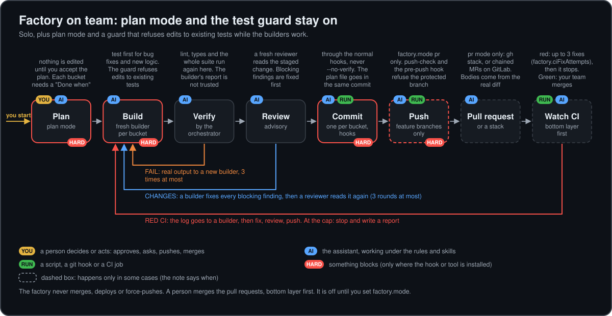
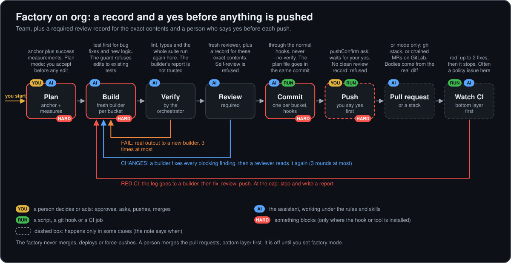
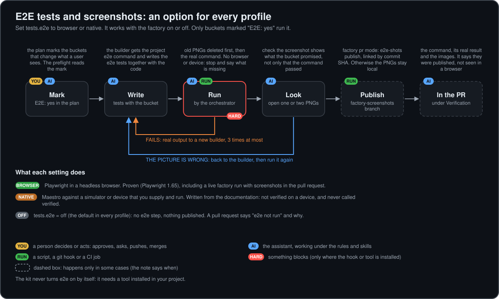

# Workspace kit

A portable set of working rules, skills, templates and checks that make an AI coding assistant (Claude Code
first, other tools through adapters) work the way a careful engineer works: plan before building, keep the
code and the docs true, prove what was done, get a second reader on the change, and ship with a clean history.
Install it with one `npx` command, answer a short questionnaire in your AI tool, and choose how strict it should
be: **solo**, **team** or **org**. It is built to sit beside the skills, hooks and workflows a project already
has, and never overwrites them.

It grew out of day-to-day work with an AI assistant, was made independent of any language or framework, and
was then aligned with Anthropic's
[AI-native SDLC playbook](https://claude.com/resources/articles/the-ai-native-sdlc-playbook).

## Quick setup

Needs Node 18 or newer and git. Five minutes, in this order. Commands go in a terminal in your project folder;
the quoted prompts are pasted into your AI tool (Claude Code, Cursor, Codex, OpenCode or Cline) opened on that
same folder.

**1. Install the kit's files** (copies them into `.claude/workspace-kit/` and touches nothing else):

```text
npx ai-workspace-kit init
```

**2. Set up the workspace.** Paste this into your AI tool:

> Read `.claude/workspace-kit/skills/setup-workspace/SKILL.md` and follow it.

The assistant asks which tools and which profile you use (**solo** for one owner, **team** for a few
developers, **org** for strict policies), explains every switchable rule, skill, hook and check in a line or two
together with what it changes in your workflow, shows a dry run, and installs only what you choose. It never
overwrites a file of yours. More in [section 8](#8-install-and-use).

**3. Check it.** Paste:

> Run `node scripts/workflow-config.mjs` and tell me which profile is active and what each control is set to.

**4. Plan your first piece of work.** Paste:

> Use the goal-first-planner skill. I want to <describe the goal>. Interview me, then plan it in small buckets.

**5. Optional: let agents carry an approved plan to pull requests** (the [factory](#the-factory-an-optional-layer)).
It is off until you turn it on. Paste:

> In `.claude/workflow.json` set `factory.mode` to `local`, show me the result with `node scripts/workflow-config.mjs`,
> and explain what `local` and `pr` do. Do not start the factory yet.

Then, with an approved `PLAN.md`, start it by hand with `/wk-run-factory` (Codex: `$wk-run-factory`). It builds,
verifies, reviews and commits each bucket; in `pr` mode it also pushes feature branches, opens the pull requests and
watches CI. It never merges. Details and what is proven: [`docs/factory.md`](docs/factory.md).

**6. Optional: end-to-end tests and screenshots** (works with the factory on or off). Paste:

> Read the `wk-e2e-tests` skill and set `tests.e2e` to `browser` for this project. Tell me what it needs installed
> first.

### Optional: stop the constant "allow this command?" pop-ups

Claude Code asks before it runs most shell commands. You can pre-approve the ones you trust once, for every
project, in your user settings file (`~/.claude/settings.json`, on Windows `C:\Users\<you>\.claude\settings.json`):

```json
{
  "permissions": {
    "defaultMode": "acceptEdits",
    "allow": ["Bash(npm run *)", "Bash(npm test *)", "Bash(git status *)", "Bash(git diff *)", "Bash(git add *)", "Bash(git commit *)"],
    "ask": ["Bash(git push *)", "Bash(git reset --hard *)"],
    "deny": ["Bash(rm -rf /*)", "Bash(rm -rf ~*)"]
  }
}
```

Merge it into the file if you already have one, restart the session, and run `/permissions` to see which rule
comes from which file. The full list, why prompts keep coming back (for example `cd` plus `>>` always asks) and the
shell habits that avoid them: [`docs/permissions.md`](docs/permissions.md).

> **Warning: this is your decision and your responsibility.** Pre-approving commands gives an AI agent the right
> to run them without asking you, and broad rules (`node *`, `python *`, `sed *`, `cp *`, `mv *`) let it run any
> script or change any file those programs can reach. A wrong or manipulated instruction can then do real damage.
> Allow only what you would let run unattended, keep your work in git, and keep credentials you cannot afford to
> lose out of reach. Anthropic advises the most permissive modes only inside a container or a virtual machine. The
> kit does not write these settings for you, and its own guards (the pre-commit and pre-push hooks, the protected
> branch, "never merge") do not replace your judgment. If you run the factory in `pr` mode, `git push` under `ask`
> is a sensible brake: moving it to `allow` means it pushes without asking.

> **Status: `ai-workspace-kit` is on npm.** Recent additions: the factory, optional end-to-end tests, GitLab support
> and single-agent flows for other tools (the README stays version-independent on purpose; the version is in
> `package.json`). It is an early version (0.x), so expect rough edges and
> [tell us about them](https://github.com/Jakub-Owczarzak/ai-workspace-kit/issues/new/choose). To remove everything
> the kit installed, see [Uninstall](#uninstall). How releases are made: [`RELEASING.md`](RELEASING.md). What is
> proven and what is not: [section 11](#11-how-it-was-checked-and-what-is-not-proven).

**See how the workflow runs:** [flow diagrams for solo, team and org](#the-flow-in-each-profile-what-is-automated-what-needs-you): each step, who does it (you, the assistant or a script), what blocks, and where you decide.

**Trying it and want to tell us how it went?** Open an issue with the *Feedback or a problem* form
([new issue](https://github.com/Jakub-Owczarzak/ai-workspace-kit/issues/new/choose)). It asks which AI tool and
operating system you used and what the installer printed; those details make a report easy to act on.

## Contents

0. [Quick setup](#quick-setup), including [fewer approval pop-ups](#optional-stop-the-constant-allow-this-command-pop-ups) and its warning
1. [What it is, and what it is not](#1-what-it-is-and-what-it-is-not)
2. [Why it was built](#2-why-it-was-built)
3. [What it is based on](#3-what-it-is-based-on)
4. [The kit at a glance](#4-the-kit-at-a-glance)
5. [The workflow, step by step](#5-the-workflow-step-by-step)
6. [The skills and how they connect](#6-the-skills-and-how-they-connect)
7. [Solo, team and org: what turns on and off](#7-solo-team-and-org-what-turns-on-and-off)
   - [Flow diagrams: what is automated, what needs you](#the-flow-in-each-profile-what-is-automated-what-needs-you)
   - [The factory, an optional layer](#the-factory-an-optional-layer), and [end-to-end tests](#end-to-end-tests-and-screenshots)
8. [Install and use](#8-install-and-use)
9. [Keeping the kit up to date](#9-keeping-the-kit-up-to-date)
10. [Design principles](#10-design-principles)
11. [How it was checked, and what is not proven](#11-how-it-was-checked-and-what-is-not-proven)
12. [What is not in the kit](#12-what-is-not-in-the-kit)
13. [Repository layout](#13-repository-layout)
14. [Glossary](#14-glossary)
15. [Credits](#15-credits)

---

## 1. What it is, and what it is not

**It is** an npm package that puts a set of plain files into a project, plus an installer that places each piece
where your AI tool reads it:

- **Rules**: short instructions the assistant follows on every change (readable code, tidy repository, docs
  kept fresh, a commit gate, honest verification, test discipline).
- **Skills**: longer procedures the assistant uses for one kind of task (plan a feature, write the project
  overview, write a pull request description, keep a changelog, sync a design, update the kit itself).
- **Templates**: starting files (`AGENTS.md` overview, `PLAN.md`, `REVIEW.md`, `CHANGELOG.md`, hook wrappers,
  a release workflow, the workflow profile).
- **Scripts and hooks**: small Node programs that check things without Claude (skill lint, `@` import
  resolver, doc-size report, stale-overview finder, test-edit guard, review gate, docs-fresh check).
- **A workflow profile**: one file, `.claude/workflow.json`, that says how strict all of the above is.
- **An installer, an uninstaller and a catalog**: `init` copies the kit into the project, `apply` installs the
  pieces you chose and records what it did, `uninstall` removes exactly that again, and `catalog/options.json` holds
  the one-line explanation of every option that the setup questionnaire shows.

**It is not** a library, a framework or a service. Nothing runs inside your app. It does not call Claude in CI,
it does not need an API key, the installer makes no network calls, and most of its rules are advice the
assistant follows, not locks. The few hard stops (a failing commit hook, a blocked push) are listed in
[section 7](#7-solo-team-and-org-what-turns-on-and-off).

## 2. Why it was built

Working with an AI assistant on a real project goes wrong in predictable ways:

| What goes wrong | What the kit does about it |
|---|---|
| Code is written before anyone agreed what it should do | A planner agrees a goal, success criteria and non-goals first (the Intent Anchor), then works in small buckets |
| The docs describe a project that no longer exists | A docs-fresh rule, a commit-time warning, and a script that finds stale lines in the overview |
| "It works" is said about something only read, never run | A verification rule: say what was run, show the output, never call read code "tested" |
| A bug is "fixed" by weakening the test | Test discipline: a failing test first, a hook that blocks edits to existing tests during a fix |
| The author is the only reader of a change | A reviewer subagent that reads the change cold, against the plan and a checklist |
| The assistant's instructions grow without anyone noticing | A skill lint, an `@` import check, and a size report for the always-loaded files |
| Every project reinvents the workflow | One kit, installed with one `npx` command and a setup prompt, upgraded by installing a newer version |
| A new tool would overwrite what the project already has | Kit skills get a `wk-` prefix, edits to your files are marked blocks, and anything that exists and differs is skipped and reported |
| One-size-fits-all strictness is too heavy for one person and too light for many | A profile (`solo`, `team`, `org`) turns each control on or off |

The workflow was first built and used day to day, then generalized into this kit so any project can use it, and
later aligned with the playbook below.

## 3. What it is based on

The kit follows Louis Claxton's **[The AI-native SDLC playbook](https://claude.com/resources/articles/the-ai-native-sdlc-playbook)**
(Anthropic, 2026-08-21), which describes six plays: Plan, Design, Build, Test, Deploy, Maintain. The kit takes
the parts that fit a repository you control and leaves out the ones that need infrastructure.

| Playbook idea | Where it is in the kit |
|---|---|
| Capture the intent in the repository before building | `goal-first-planner` and `templates/PLAN.md` |
| Nothing is implemented without an accepted plan | `planning.gates` (a rule, with plan mode as an optional hard stop) |
| A short CLAUDE.md with commands and conventions | `templates/AGENTS.md`, `write-project-overview`, the doc-size report |
| Skills as institutional knowledge, tested for triggering | `skills/`, `triggers.json` fixtures, the skill lint, the opt-in trigger runner |
| Hooks as guardrails | The test-edit guard, the docs-fresh check, the commit and push hooks |
| A feedback loop: tests, build, pasted output | `verification` and `test-discipline` rules |
| A bug fix starts with a failing test; a hook protects tests | `test-discipline` and `test-edit-guard.mjs` |
| An independent review with a `REVIEW.md` | The `reviewer` subagent, `templates/REVIEW.md`, the review gate |
| One source of truth per artifact | The `docs-fresh` rule and the Sources of truth list in the overview |

Where the kit differs on purpose (overview size, test-first for new logic, one `PLAN.md`, a review record that is
an attestation, strictness by profile, and what is left out) is written down in
**[`docs/playbook-mapping.md`](docs/playbook-mapping.md)**, which also scores 27 playbook practices: Covered 6,
Partly 12, Differs by decision 3, Out of scope by decision 5, kit addition 1, each with how it was checked.

## 4. The kit at a glance

The kit is an npm package and a git repository. `init` copies it into the project's own `.claude/workspace-kit/`
folder; the setup prompt and the `apply` program then put each piece you chose where it is used.

```text
 THE PACKAGE (this repository)                      YOUR PROJECT
 -----------------------------                      ------------
 npx ... init  ---copies everything--->             .claude/workspace-kit/     the kit's own folder
                                                          |   setup prompt + `apply`: only what you choose
                                                          v
 rules/        8 short rules          --apply-->    a marked block in CLAUDE.md (Claude Code alone)
                                                    or in AGENTS.md (any other tool)
 skills/       12 skills              --apply-->    .claude/skills/wk-<name>/   (or .agents/skills/, .cline/skills/)
 templates/    AGENTS.md, PLAN.md,    --apply-->    AGENTS.md, PLAN.md, REVIEW.md, CHANGELOG.md (only if missing),
               REVIEW.md, agents/,                  .claude/agents/reviewer.md, .claude/workflow.json,
               workflow.json, hooks/                a marked block in your git hooks (pre-commit, pre-push)
 templates/scripts/  the checks       --apply-->    scripts/*.mjs
 catalog/      every option, explained (read by the questionnaire)
 bin/ lib/     the installer: init, apply, uninstall (copied too, so setup needs no network)
 docs/ adapters/ stacks/                            reference only; they stay in .claude/workspace-kit/
```

In a project the skills are named `wk-<name>` so they cannot clash with skills the project already has. The rest
of this README uses the plain names.

What reads what, inside a project:

```text
   .claude/workflow.json   (profile: solo | team | org, plus overrides; resolved by scripts/workflow-config.mjs)
        |
        |  each piece reads the control it needs:
        |
        +-- planning.gates ........... the planner skill, the router skill, the planning-gate line in CLAUDE.md
        +-- tests.tdd, tests.guard ... the test-discipline rule; test-edit-guard.mjs (tests.guard)
        +-- docs.check ............... check-docs-fresh.mjs, run by the commit hook
        +-- review.mode .............. the commit-gate rule (the assistant runs the reviewer);
        |                              check-review-gate.mjs, run by the pre-push hook
        +-- docs.sizeWarnChars ....... doc-size.mjs
        +-- static.checks ............ check-config.mjs (skill lint, @ imports)
        `-- claude.runChecks ......... run-claude-checks.mjs (opt-in)

   The files the workflow keeps in step:
        AGENTS.md (overview) <---- docs-fresh rule, write-project-overview, overview-check.mjs
        PLAN.md ................. written by the planner, read by the reviewer, updated with the work
        .claude/reviews/<tree>.md  written after a review, read by the pre-push hook
```

## 5. The workflow, step by step

The whole path of one change, from request to a maintained project. Each step names the pieces involved, the
control that tunes it, and what can stop you. Step 0 happens once per project.

```text
   REQUEST
      |
      v
   1 PLAN ......... goal-first-planner writes PLAN.md (Intent Anchor, bucket plan); you approve
      |             tuned by: planning.gates (off | anchor | full)
      v
   2 BUILD ........ rules always on; workspace-router sends the assistant to the right skill
      |             guards: docs-fresh, test discipline (+ test-edit guard), ui-change flagging
      v
   3 VERIFY ....... lint, type check, tests; the real output is shown
      |
      v
   4 REVIEW ....... reviewer subagent checks the change against PLAN.md and REVIEW.md
      |             tuned by: review.mode (off | advisory | required)
      |             blocking finding?  yes --> back to 2 (fix), then review again
      v
   5 COMMIT ....... commit gate: checks, design sync if UI rows are pending, changelog entry
      |             hook: lint-staged, type check, tests, docs-fresh check, changelog
      v
   6 PUSH ......... pre-push hook: no direct push to the protected branch you named; review gate
      |             tuned by: review.mode
      v
   7 PULL REQUEST . pr-description writes the text; CI runs; merge; the release workflow bumps the version
      |
      v
   8 KEEP IT TRUE . write-project-overview (refresh), check-config, update-workspace-kit
```

### Step 0: install (once per project)

```text
   npx ai-workspace-kit init      copies the kit to .claude/workspace-kit/ (all or nothing; nothing else touched)
      |
      v
   prompt: "Read .claude/workspace-kit/skills/setup-workspace/SKILL.md and follow it"
      |
      v
   look at the project, read-only (stack, branch, hooks, CI, commands, existing assistant files, existing skills)
      |
      v
   questionnaire from catalog/options.json, rounds of at most four questions:
      1 tools + profile   2 strictness controls   3 what to install, a group at a time   4 project facts
      |
      v
   answers.json --> apply --dry-run (created / skipped / manual / notes / warnings) --> you say yes --> apply
      +--> skills ............ wk-<name>/ in the folder(s) your tools read
      +--> rules ............. one marked block in CLAUDE.md or AGENTS.md
      +--> templates ......... PLAN.md, REVIEW.md, CHANGELOG.md (only if missing; never replaced)
      +--> workflow profile .. .claude/workflow.json
      +--> scripts + hooks ... scripts/*.mjs; a marked block chained into your pre-commit / pre-push
      +--> settings .......... .claude/settings.json keys added (plan mode for team and org, the test-edit guard)
      |
      v
   finish the MANUAL lines, verify (scripts run, no leftover placeholders, a second apply changes nothing)
      --> summary --> no commit
```

Skills involved: `setup-workspace` (started by hand; it stays in the kit folder), then `write-project-overview`
when `AGENTS.md` does not exist. Details and the safety rules: [section 8](#8-install-and-use).

### Step 1: plan

```text
   (the planner's own phases are called P0 to P5 here, to keep them apart from the workflow steps)

   P0 gather context (read the repo, do not ask what the files answer)
      |
   P1 goal interview (rounds of 3-5 questions): outcome, why now, success, non-goals, constraints, risks
      |
   P2 INTENT ANCHOR ....... goal, success criteria, non-goals, constraints (your words), assumptions, risks
      |                     you approve  --> saved in PLAN.md
   P3 BUCKET MAP .......... 3-8 small buckets, each with something visible or testable; you approve
      |
   P4 PER-BUCKET PLAN ..... steps, output, done when, verify by, TDD yes/no, review focus, risks
      |                     you approve  --> copied into PLAN.md "Current bucket"
      v
   build the bucket
      |
   P5 CHECKPOINT .......... what was done, verification, drift check against the Intent Anchor,
      |                     decisions logged, "proceed, adjust or stop?"
      +---------------------> next bucket (back to P4)
```

When it applies is the `planning.gates` control:

```text
   planning.gates = off ...... the planner runs only when you ask for a plan (set it yourself; no profile uses it)
   planning.gates = anchor ... non-trivial work needs an approved Intent Anchor in PLAN.md before any code
                               (the default in solo and team)
   planning.gates = full ..... the same, plus success measurements (metric, baseline -> target, how measured)

   routine work is exempt (a tight request, a small blast radius, code the tests already cover)
   anchor/full is a rule the assistant follows; plan mode (offered by setup) is the real stop in the terminal
```

Skills involved: `goal-first-planner`. Files: `PLAN.md` (read later by the reviewer). The plan is updated in the
same commit as the work it describes.

### Step 2: build

Always-on rules shape every change. The router skill tells the assistant which skill to read for the task.

```text
   a task arrives
      |
      v
   workspace-router (read once per session) --> reads the skill for the area, not just its description
      |
      +--> rules in force on every change:
      |      readable-code    full-word names, small units, one source of truth, failure handled on purpose
      |      repo-tidiness    every file has one home, listed in AGENTS.md; extend, do not duplicate
      |      docs-fresh       update the documents that describe the change, in the same turn
      |      verification     check names, numbers and paths against the code before writing them
      |      skill-routing    read a skill whole before using it; project files outrank notes and memory
      |      ui-change-flagging (only with a design file) one row per visible UI change
      v
   change the code + the documents it makes false
```

A bug fix has its own path, because the test is the proof:

```text
   bug reported
      |
      v
   write a test that reproduces it; run it; SHOW it failing for the expected reason
      |
      |   with tests.guard on:  node scripts/test-edit-guard.mjs start --reason "<what is fixed>"
      |   ... write the failing test(s), then:  node scripts/test-edit-guard.mjs lock
      v
   change the CODE (the guard blocks edits to existing test files; never weaken the test)
      |
      v
   run the test: passing; run the whole suite; show both outputs
      |   with tests.guard on:  node scripts/test-edit-guard.mjs stop
      v
   done
```

New logic is test-first when `tests.tdd` is `on`, or when the plan marks the bucket `TDD: yes`.

### Step 3: verify

The assistant runs the project's lint, type check and tests, and reports the command and its real output
(counts, exit status). What cannot be tested (a screen, a device) is said plainly. "Tested" is never said about
something that was only read. Rules: `verification`, `test-discipline`.

### Step 4: review

```text
   changes staged
      |
      v
   node scripts/check-review-gate.mjs --staged
      |
      +-- "review-gate: ok" ----------------------------------> go to step 5
      |
      +-- no clean record for these exact contents
             |
             v
          reviewer subagent (fresh context; Read, Grep, Glob, Bash; told to change nothing)
             |   reads PLAN.md (Intent Anchor, current bucket "Done when"), REVIEW.md, AGENTS.md
             |   reads the diff, runs lint / type check / tests, walks the checklist
             v
          report: blocking findings first, then at most five others, ending "Blocking: <n>"
             |
             +-- blocking > 0 --> fix --> review again (changed contents need a new record)
             |
             v
          node scripts/check-review-gate.mjs record --blocking <n> --summary "..." --findings-file ...
             |     writes .claude/reviews/<git tree id>.md
             v
          go to step 5
```

`review.mode` decides how much this matters: `off` (only when asked), `advisory` (the assistant runs it; the push
hook only reminds), `required` (the push hook blocks a push whose contents have no clean record).
The record names a git **tree** (the exact file contents), so a review made before the commit still matches the
commit made right after it, and any later edit makes the record stale.

### Step 5: commit

The commit gate has a fixed order:

```text
   1 fix lint, type and test errors ...... never commit with any failing
   2 run the review ...................... step 4
   3 design sync ......................... only if the pending-changes list has rows (figma-sync)
   4 commit .............................. the hook runs:
          lint-staged / lint  -->  type check  -->  tests  -->  docs-fresh check  -->  changelog entry
   5 only a human pushes
```

The docs-fresh check (`docs.check`) says when source changed but `AGENTS.md` is not in the commit: `warn` prints a
message, `strict` blocks the commit. The changelog step asks for a bump type and a one-line entry (or reads
`CHANGELOG_BUMP` and `CHANGELOG_ENTRY` for a commit with no terminal). Merges and commits that only touch the
changelog or the lock file are skipped. Skill: `changelog-bump`.

### Step 6: push

```text
   git push
      |
      v
   pre-push hook, for each ref being pushed
      |
      +--> is it the protected branch (the one you named at setup, for example main)? --yes--> BLOCKED:
      |      push a branch, open a pull request
      |
      +--> review gate on the tip of the ref (review.mode)
             off .......... silent
             advisory ..... a reminder if there is no clean record; the push goes ahead
             required ..... BLOCKED if there is no record, or the record has blocking findings
      v
   pushed   (the hook fails open: no git, a crash, or no node on the PATH never stops a push)
```

Assistants commit when asked and never push; a person pushes. **The one exception is the opt-in
[factory](#the-factory-an-optional-layer)**: when you set `factory.mode` to `pr` and start it by hand, it may push
**feature branches** (never the protected branch, which the hook still refuses) and open pull requests. It never
merges.

### Step 7: pull request and release

```text
   pr-description ---> reads the real diff, commits and PLAN.md; writes the text (never opens the PR)
        |
        v
   you open the PR; the project's own CI runs (the kit ships only the release workflow template, no test CI)
        |
        v
   merge to main
        |
        v
   release_bump workflow (template) ---> opens a release PR: bumps the version files, folds
                                         "Unreleased" in CHANGELOG.md into a version heading
```

Skills involved: `pr-description`, `changelog-bump`. Template: `templates/workflows/release_bump.yaml`.

### Step 8: keep it true

```text
   the overview may be stale?
      |
      v
   write-project-overview, refresh mode
      |   node scripts/overview-check.mjs  --> missing paths, missing npm scripts, version mismatches,
      |                                        forgotten folder entries, leftover planning labels
      |   + the assistant reads the lines the script cannot judge
      v
   a table of problems (line, statement, status, evidence, proposed edit) --> you approve LINE BY LINE
      v
   only the approved lines change; "Last updated" is set; the check runs again

   the setup may have drifted?
      |
      v
   node scripts/check-config.mjs  --> skill lint, @ imports, doc size  (no Claude needed)

   the kit has improvements, or the project made one?
      |
      v
   a newer kit version:  npx ...@latest init --force, review the diff, apply again (section 9)
   a project improvement for the kit:  update-workspace-kit, PUSH mode (project -> kit), always asks first
```

## 6. The skills and how they connect

Twelve skills (`run-factory` and `e2e-tests` are the newest). In a project they are installed as `wk-<name>` (so `/wk-pr-description`); this page uses the plain
names. **Started by hand** means only you can start it (`/name`); otherwise Claude may pick it from its
description. The profile does not install or remove skills; you choose the skills at setup, and the profile
changes how strictly the workflow uses them.

| Skill | Started | Use when | Reads which controls | Produces | Connected to |
|---|---|---|---|---|---|
| `setup-workspace` | by hand | Once per project, to install the kit | asks for the profile | the installed pieces, `.claude/workflow.json` | installs all the others |
| `workspace-router` | by Claude | Start of work, to pick the skill or document for a task | `planning.gates` (in its standing rules) | a decision about which skill to read | routes to every skill below |
| `goal-first-planner` | by Claude | Starting a feature or project | `planning.gates` (it writes a `TDD: yes or no` line; the test-discipline rule reads that line together with `tests.tdd`) | `PLAN.md` | the `reviewer` reads `PLAN.md` |
| `write-project-overview` | by Claude | No `AGENTS.md` yet, or a stale one | none | `AGENTS.md` (create) or approved line edits (refresh) | runs `overview-check.mjs`; feeds `docs-fresh` |
| `changelog-bump` | by Claude | A commit needs a changelog entry, or a release bumps the version | none | `CHANGELOG.md`, version files | called by the commit hook and the release workflow |
| `pr-description` | by Claude | Writing the pull request text | none | text only | reads the diff and `PLAN.md` |
| `readable-fix-plan` | by Claude | Turning review findings or a bug list into one plan | none | a verified, clickable fix plan | takes findings from the reviewer or a harsh review |
| `figma-sync` | by Claude | UI changes are pending, or you ask to align the design | none | frames in Figma, `FIGMA-SYNC.md` | fed by the `ui-change-flagging` rule; runs before the commit |
| `ultra-code-quality-review` | by hand | You want a deliberately harsh maintainability review | none | a structural review | separate from the review gate; it does not leave a review record |
| `update-workspace-kit` | by Claude | A change you made in the project is reusable and should go back into the kit (push mode; its pull mode predates the npm package, see [section 9](#9-keeping-the-kit-up-to-date)) | none | kit changes on a branch | talks to the kit repository |

The `reviewer` is a **subagent**, not a skill: a file in `.claude/agents/` that the assistant starts as a fresh
reader at step 4. It is tuned by `review.mode`.

How they connect:

```text
   setup-workspace --installs--> everything        update-workspace-kit --push--> KIT REPOSITORY

   workspace-router
      |--routes--> goal-first-planner --writes--> PLAN.md --read by--> reviewer --writes--> review record
      |                                                                                         |
      |                                                                               read by check-review-gate
      |                                                                               (pre-push hook)
      |--routes--> write-project-overview --writes--> AGENTS.md <--checked by-- overview-check.mjs
      |--routes--> figma-sync <--rows from-- ui-change-flagging rule
      |--routes--> readable-fix-plan <--findings from-- reviewer / ultra code quality review
      |--routes--> pr-description (reads the diff + PLAN.md)
      `--routes--> changelog-bump <--called by-- pre-commit hook, release_bump workflow
```

## 7. Solo, team and org: what turns on and off

One file sets it: `.claude/workflow.json`.

```json
{ "profile": "solo", "overrides": { "docs.check": "strict" } }
```

| Profile | For | In one line |
|---|---|---|
| `solo` (default) | One owner who reads every diff and approves every step | Light: advice and warnings; the Intent Anchor is agreed before non-trivial work; nothing blocks except the hooks you installed |
| `team` | A few developers on a shared repository | Adds the test-edit guard and test-first for new logic |
| `org` | Many developers, policies that must hold | Strict: the docs check blocks a commit, a clean review record is required to push, success measurements are recorded |

Pick the smallest profile that fits. A control that blocks costs time every day; turn one on when the risk it
removes is real, not because it exists. Skills are installed or not at setup; the profile changes how strictly
the workflow requires them.

### The flow in each profile: what is automated, what needs you

Every step is tagged with **who acts** and **how it is enforced**:

```text
   WHO ACTS    YOU   a person decides or acts: approves, asks, types, pushes, merges   <-- human in the loop
               AI    the assistant, working under the always-on rules and skills
               RUN   a script, a git hook or a CI job; no assistant and no person needed

   ENFORCED    soft  a rule or a warning: the assistant follows it, nothing stops you
               HARD  something blocks (a hook exit code or a tool). It exists only where it is installed,
                     and a person can bypass it on purpose (--no-verify, REVIEW_MODE=off)
               off   not applied in this profile
```

The kit is a **human-in-the-loop** workflow. In no profile does anything push, open a pull request or merge by
itself. The profile changes how much is blocked by a machine, not whether a person decides.

#### Solo: one owner who reads every diff and approves every step


<details>
<summary>Text version of the solo flow</summary>

```text
   YOU   ask for a change
    |
    v
 1 PLAN     AI    gathers context, interviews you, drafts the Intent Anchor        planning.gates = anchor, soft
    |       YOU   approve the Intent Anchor, then the bucket map, then each bucket's plan
    |             (a tight, small, already-tested change is exempt; plan mode is not offered)
    v
 2 BUILD    AI    router picks the skill; the always-on rules shape the change                  soft
    |             a bug fix starts with a failing test; new logic is test-first only when a bucket says TDD: yes
    |       off   test-edit guard: nothing stops an edit to an existing test; the rule says never weaken one
    |       YOU   answer "proceed, adjust or stop?" after each bucket
    v
 3 VERIFY   AI    runs lint, types and tests, shows the real output, says what was not checked   soft
    v
 4 REVIEW   AI    starts the reviewer subagent on the staged change, fixes its blocking   review.mode = advisory, soft
    |             findings; a blocking finding sends it back to step 2, then review again
    v
 5 COMMIT   YOU   ask for the commit (assistants commit when asked)
    |       RUN   pre-commit hook, if you installed it: lint, types, tests                                  HARD
    |       RUN   docs-fresh check: source changed but AGENTS.md did not                   docs.check = warn, soft
    |       YOU   changelog: the bump type and one line, typed in the terminal (or the assistant supplies the
    |             two values when it commits for you)
    v
 6 PUSH     YOU   push. Assistants never push
    |       RUN   pre-push hook, if installed: refuses the protected branch you named                       HARD
    |       RUN   review gate: a reminder if this content has no clean review record                 soft (reminder)
    v
 7 PR       AI    pr-description drafts the text from the real diff
            YOU   open the pull request, let your own CI run, merge
            RUN   release workflow (optional): opens a release PR after the merge;  YOU merge it = the release
```

</details>

#### Team: a few developers on a shared repository


Same as solo, plus a real stop on planning, and a guard that protects tests during a bug fix.

<details>
<summary>Text version of the team flow</summary>

```text
   YOU   ask for a change
    |
    v
 1 PLAN     AI    interviews you, drafts the Intent Anchor                         planning.gates = anchor, soft
    |       YOU   approve the Intent Anchor, the bucket map, each bucket's plan
    |       RUN   plan mode, offered at setup: the terminal session cannot edit any file until
    |       YOU   accept the plan                                                                          HARD
    v
 2 BUILD    AI    router, always-on rules; NEW LOGIC IS TEST-FIRST                         tests.tdd = on, soft
    |
    |       a BUG FIX goes through fix mode (tests.guard = on):
    |          AI    writes a test that reproduces the bug and shows it FAILING for the right reason
    |          AI    node scripts/test-edit-guard.mjs start, then lock (the assistant starts fix mode)
    |          RUN   from here an Edit, Write or MultiEdit on an existing test file is refused               HARD
    |          AI    changes the code only; runs the test, then the whole suite; then stop
    |
    |       YOU   answer "proceed, adjust or stop?" after each bucket
    v
 3 VERIFY   AI    lint, types, tests, real output                                                       soft
    v
 4 REVIEW   AI    reviewer subagent on the staged change; fixes blocking findings            review.mode = advisory
    v
 5 COMMIT   YOU   ask for the commit; type the changelog bump and line (or the assistant supplies them)
    |       RUN   pre-commit hook: lint, types, tests                                                     HARD
    |       RUN   docs-fresh check                                                           docs.check = warn, soft
    v
 6 PUSH     YOU   push
    |       RUN   pre-push hook: protected branch refused                                                  HARD
    |       RUN   review gate: reminder if there is no clean record                                  soft (reminder)
    v
 7 PR       AI    pr-description drafts the text      YOU  open the PR, CI, merge      RUN  release PR (optional)
```

</details>

#### Org: many developers, policies that must hold


Same as team, plus success measurements, and three more things that block: the docs check, the review record at
push, and plan mode as the default.

<details>
<summary>Text version of the org flow</summary>

```text
   YOU   ask for a change
    |
    v
 1 PLAN     AI    interviews you; drafts the Intent Anchor AND the success measurements    planning.gates = full
    |             (metric, baseline -> target, how it is measured)
    |       YOU   approve the anchor, the bucket map, each bucket's plan
    |       RUN   plan mode is the session default: no file edit until
    |       YOU   accept the plan                                                                          HARD
    v
 2 BUILD    AI    router, always-on rules; new logic test-first                            tests.tdd = on, soft
    |             bug fix in fix mode: failing test first, then the guard protects existing tests          HARD
    |       YOU   answer "proceed, adjust or stop?" after each bucket
    v
 3 VERIFY   AI    lint, types, tests, real output                                                       soft
    v
 4 REVIEW   AI    MUST run the reviewer subagent on the staged change, fix its blocking    review.mode = required
    |             findings, and record the result (.claude/reviews/<tree>.md); changed content needs a new record
    v
 5 COMMIT   YOU   ask for the commit; changelog bump and line
    |       RUN   pre-commit hook: lint, types, tests                                                     HARD
    |       RUN   docs-fresh check: source changed but AGENTS.md did not                    docs.check = strict, HARD
    |             the commit is blocked until the overview is part of it
    v
 6 PUSH     YOU   push
    |       RUN   pre-push hook: protected branch refused                                                  HARD
    |       RUN   review gate: refused when the content has no clean record, or the record has blocking
    |             findings                                                                                 HARD
    v
 7 PR       AI    pr-description drafts the text      YOU  open the PR, CI, review by your colleagues, merge
            RUN   release PR (optional)               YOU  merge it
```

</details>

Two limits to keep in mind in `org`. The review record is an attestation: the assistant that wrote the change can
write it, so the push check is a reminder with teeth, not independent proof. And a second person reading the pull
request, branch protection and required CI are your project's own settings; the kit neither reads nor sets them.

#### Test first and bug fixes: the test comes before the code

In the diagrams above, **Test first** is a stage of its own, before **Build**: the failing test is the proof, so
it is written and shown failing before any code is changed. This diagram zooms in on that part and on what
each profile changes (the rule is [`rules/test-discipline.md`](rules/test-discipline.md); the policy is in
[`docs/test-discipline.md`](docs/test-discipline.md)).

Turning test-first off (`tests.tdd = off`) removes the **Test first** stage, not the tests: the assistant still
runs the whole suite in **Verify**, the commit gate still says never to commit with a failing test, and the
pre-commit hook still runs the tests. Only the rule "write the failing test first" goes away.



#### Where a person is in the loop

| Moment | solo | team | org | What the person does |
|---|---|---|---|---|
| Approve the Intent Anchor, the bucket map and each bucket plan | yes | yes | yes (plus the success measurements) | **Approves** before any non-trivial code |
| Accept the plan before any edit (plan mode) | no | yes | yes | **Accepts**; a real stop in the terminal |
| "Proceed, adjust or stop?" after each bucket | yes | yes | yes | **Decides** |
| Read the change | you read the diff; the reviewer is advisory | same | the reviewer must run and record; you still decide | **Judges** |
| A test that looks wrong while fixing a bug | yes | yes | yes | **Decides**: the assistant stops, says why and asks; it never edits, skips or weakens the test on its own |
| Ask for the commit | yes | yes | yes | **Asks**; assistants commit only when asked |
| Changelog bump and one-line entry | yes | yes | yes | **Types** it (or the assistant supplies it when it commits for you) |
| Refresh the overview (`write-project-overview`) | yes | yes | yes | **Approves line by line**; only approved lines change |
| Design sync (`figma-sync`, if used) | yes | yes | yes | **Approves** the plan before anything is drawn or written |
| Approve the setup preview (`apply --dry-run`) | yes | yes | yes | **Says yes** before anything is installed |
| Push | yes | yes | yes | **Pushes**; assistants never push (unless you started the factory in `pr` mode: then feature branches only, and in org it asks for a yes first) |
| Open the pull request, merge | yes | yes | yes | **Merges** always; the kit drafts the text, and the factory (if you started it) opens the pull requests |
| Start the factory (`/wk-run-factory`) | optional | optional | optional | **Starts it by hand**; that is the approval to carry the approved plan through |
| Merge the release PR (if the release workflow is installed) | yes | yes | yes | **Merges**; that is the release |

What runs without a person, in every profile: the always-on rules and the router, the verification and
test-discipline rules, the reviewer subagent when the assistant starts it, the commit and push hooks, the
test-edit guard, the config checks, and the release workflow's opening of a release PR.

The controls, as a table:

| Step or piece | solo | team | org |
|---|---|---|---|
| Planning before code (`planning.gates`) | `anchor`: soft rule | `anchor`: soft rule | `full`: soft rule + measurements |
| Always-on rules (readable code, tidy repo, docs fresh, verification) | on | on | on |
| Test-edit guard in fix mode (`tests.guard`) | off | on | on |
| Bug fix starts with a failing test | rule | rule | rule |
| New logic test-first (`tests.tdd`) | `bugs`: only when a bucket says `TDD: yes` | `on`: rule | `on`: rule |
| Reviewer before a commit (`review.mode`) | `advisory` | `advisory` | `required` |
| Push blocked without a clean review record | no (reminder) | no (reminder) | yes |
| Docs-fresh check at commit (`docs.check`) | `warn` | `warn` | `strict` (blocks) |
| Doc-size warning (`docs.sizeWarnChars`) | 40,000 characters | 40,000 | 40,000 |
| Static checks: skill lint, `@` imports (`static.checks`) | on | on | on |
| Checks that run `claude -p` (`claude.runChecks`) | off (opt-in) | off (opt-in) | off (opt-in) |
| Plan mode as the session default | not offered | offered | offered |
| Factory (`factory.mode`) | `off` | `off` | `off` (opt in; org asks before each push and allows 2 CI fixes) |
| End-to-end tests (`tests.e2e`) | `off` | `off` | `off` (opt in: `browser` or `native`) |
| Commit hook, push hook, changelog | your install choice, the same in every profile | | |

### The factory, an optional layer

The profiles above end with "you push". The **factory** is an opt-in layer on top of any profile for people who want
the assistants to carry an approved plan further. **It is off in every profile** (`factory.mode: off`). You turn it
on, approve a plan, and start it by hand with `/wk-run-factory`. Then, without further prompts:

1. a fresh **builder** subagent builds each bucket of the plan, and never commits or pushes;
2. the orchestrator runs lint, types and the tests itself and does not trust the builder's report;
3. a fresh **reviewer** subagent reads the change (blocking findings go back to a builder, three rounds at most);
4. one commit per bucket, through the normal hooks;
5. in `factory.mode: pr`: `push-check`, then it pushes **feature branches only**, opens the pull request or a **stack**
   of them (`gh stack` on GitHub, chained merge requests on GitLab, one PR per bucket where neither works), and watches
   CI, bottom layer first. A red layer gets a capped number of fixes (`factory.ciFixAttempts`: 3, org 2), then it stops
   and writes a report. In `local` mode it writes the PR text and stops before any push.

**It never merges, never deploys, never force-pushes, and the pre-push hook still refuses the protected branch.**
A person merges, bottom layer first.

What changes per profile:

| | solo | team | org |
|---|---|---|---|
| Plan | you approve it | plan mode: no edit until you accept | plan mode, plus success measurements |
| Builders | fresh subagent per bucket | same, and the test guard refuses edits to existing tests | same as team |
| Review | `advisory` | `advisory` | `required`: a recorded result for the exact contents; a self-review does not count |
| Push (`pr` mode) | automatic (`pushConfirm: auto`) | automatic | asks you for a clear yes first (`pushConfirm: ask`) |
| CI fix attempts | 3 | 3 | 2 |







**What is proven, and what is not** (details and the exact list: [`docs/factory.md`](docs/factory.md),
[`docs/factory-rehearsal.md`](docs/factory-rehearsal.md)):

| Proven in a live run | Not proven |
|---|---|
| GitHub: a two-bucket stack with `gh stack`, a red lower layer, a fix, a restack, green CI. Chained PRs opened with plain `git push` and `gh pr create` (the route without `gh stack`), with CI, a fix and a restack | `prLayout: single` with `factory.mode: local` on a small project: one branch, one commit per bucket, nothing pushed, the PR text written | A `single` layout in `pr` mode |
| GitLab (gitlab.com): chained merge requests, a red bottom layer, a fix, a no-force restack, green | A self-managed GitLab server |
| A real CI pipeline with a fixable and an unfixable red check (and a one-line documentation fix made by the orchestrator under `factory.fastFix: docs`, approved by `fast-check`, with no builder or reviewer): found, read, fixed by a fresh builder, re-reviewed, restacked by merge with no force push; a stop with a written report for a check that needs an outside approval (twice); the counter's stop (`ciFixAttempts: 0`, report-only) with a report; a resume in a fresh session that rebuilds nothing and watches CI | The attempt counter's stop with a positive cap, reached after real fix attempts in a live loop (the live stop was with `ciFixAttempts: 0`; the earlier stops were the agent's judgment) |
| `org` profile, end to end on a small project: `pushConfirm: ask` stopped before the first push, a `[bug]` from the reviewer was fixed and re-reviewed before any PR, a recorded review for every pushed tip (a CI fix and a merge commit included) passed the required pre-push gate, and the by-hand restack worked | `org` on a large project; a yes for each later push (the skill now asks, not yet run) |
| The kit's own tests and install smoke test on Ubuntu, macOS and Windows with Node 18 and 22 (CI, all six jobs green); an install matrix from the packed tarball, 12 combinations (Windows only) | The matrix on macOS and Linux (it is not part of CI yet) |
| Browser e2e with screenshots in the PR body | Native e2e; any tool other than Claude Code (Cursor, Codex, OpenCode, Cline were written from their documentation and not run) |

Outside Claude Code the factory runs as a **single agent**: the same steps as separate passes, with no fresh context
and no independent reader. Its review is a labeled self-review, which the gate does not count under
`review.mode: required`, so the push stops and asks you. Each subagent also carries a fixed prompt prefix that is
re-read every turn, so even a small change costs real tokens; measuring and reducing that is planned work
([`PLAN.md`](PLAN.md)).

#### End-to-end tests and screenshots

`tests.e2e` is an option for **every profile, with the factory on or off**: `browser` (Playwright in a headless
browser) or `native` (Maestro against a simulator or device you supply). It is `off` by default because it needs a
tool installed in your project; the kit never turns it on. Only buckets the plan marks `E2E: yes` run it. In the
factory, the screenshots go to a separate `factory-screenshots` branch and appear in the PR body under Verification,
with a plain statement that the images were published, not seen in a browser. Browser e2e is proven; native is
written from the tool's documentation and **not verified on a device**.



### Turning pieces on and off: what changes in the flow

The profile sets how strictly the workflow uses a piece. Whether a piece is **installed at all** is your choice at
setup (and you can run the setup again). Each row says what the flow looks like with the piece on and off.

| Piece (how it is turned off) | With it on | With it off, the flow becomes | Who is affected |
|---|---|---|---|
| **Planner**: `planning.gates = off`, or `goal-first-planner` not installed | Non-trivial work waits for an approved Intent Anchor; a checkpoint after each bucket | The assistant starts from your request. No written goal, no checkpoints: you steer by reading the diff | You lose the approval points of step 1 |
| **Plan mode default**: not chosen at setup (solo) | The terminal session cannot edit until you accept a plan; the only hard stop on planning | Planning is a soft rule the assistant follows. Not read by the VS Code extension in any case | You accept less, the assistant is trusted more |
| **Router**: `workspace-router` not installed | The assistant reads the skill that fits before it starts | It may work from memory; a skill is used only when you call it or its description matches | You get less consistent use of the other skills |
| **Test-edit guard**: `tests.guard = off` | During a bug fix an edit to an existing test file is refused | The rule still says never weaken a test, but nothing stops it; you would notice in the diff | Review carries the load |
| **Test-first**: `tests.tdd` = `off` / `bugs` / `on` | `on`: new logic too is test-first | `bugs`: only bug fixes, and buckets marked `TDD: yes`. `off`: no rule | You decide what counts as proof |
| **Reviewer and review gate**: `review.mode` | `advisory`: the assistant reviews before every commit; the push hook only reminds. `required`: the push hook refuses without a clean record | `off`: a review happens only when you ask, and the push hook says nothing. **Not installed at all**: no reviewer, no `REVIEW.md`, no record; step 4 disappears and you are the only reader | You |
| **Commit hook**: not installed | Lint, types and tests run on every commit and block it when they fail | Nothing stops a commit with failing checks; the commit-gate rule tells the assistant to run them (soft). No docs check, no changelog prompt | You |
| **Docs-fresh check**: `docs.check` = `off` / `warn` / `strict` | `strict` blocks a commit that changes source without the overview; `warn` prints a message | `off`: silent. The docs-fresh rule still asks the assistant to update the overview | You |
| **Changelog**: `changelog-bump` not installed | Every commit that changes behaviour carries a bump type and an entry | No changelog, no version bump; the release workflow cannot run (it needs this skill) | You |
| **Release workflow**: not installed | After a merge to the protected branch a release PR is opened; merging it is the release | You bump versions and the changelog by hand | You |
| **Push hook**: not installed | The protected branch is refused; the review gate runs at push | Nothing blocks a push to the protected branch except the commit-gate rule (soft). GitHub branch protection is outside the kit | You |
| **`pr-description`**: not installed | The pull request text is drafted from the real diff and `PLAN.md` | You write it | You |
| **Overview skill**: `write-project-overview` not installed | `AGENTS.md` is written from the code and refreshed with your line-by-line approval | You keep `AGENTS.md` by hand; the docs-fresh check still compares it against changes | You |
| **Design sync**: `figma-sync` and `ui-change-flagging` not installed (off by default) | UI changes are logged turn by turn; before the commit the assistant shows its plan and asks before it draws or writes anything | No design step | You approve less |
| **Harsh review**: `ultra-code-quality-review` | Runs only when you call it; it is not part of the gate and leaves no record | Nothing; the normal review is unaffected | You |
| **Claude-powered checks**: `claude.runChecks` = `false` (default) | You can run the two checks that call `claude -p`; they use your Claude usage and never run from a hook or CI | They cannot run | You start them |

### Changing it

```text
   edit .claude/workflow.json   "profile": "solo" | "team" | "org"
   one control               "overrides": { "docs.check": "strict" }
   one command only          DOCS_CHECK=strict git commit ...      (each control has an environment variable)
   whole profile, one command WORKFLOW_PROFILE=org <command>
   see the result            node scripts/workflow-config.mjs      (prints every control and where it came from)
```

Precedence: environment variable, then `overrides`, then the profile default. A missing or broken file means
`solo`, with a warning. Full table of the controls, with the reason for each profile's value:
[`docs/workflow-profiles.md`](docs/workflow-profiles.md).

### Hard stops, in one place

| Stop | When it blocks |
|---|---|
| Commit hook: lint, type check, tests | Always, if you installed the hook and a check fails |
| Docs-fresh check | `docs.check` is `strict` (org by default) |
| Test-edit guard | `tests.guard` is `on` (team and org), the PreToolUse entry is in `.claude/settings.json`, and fix mode was started with `start`; it blocks edits made by Claude (Edit, Write, MultiEdit) |
| Pre-push: protected branch | Always, if you installed the push hook and named a protected branch at setup |
| Pre-push: review gate | `review.mode` is `required` (org by default) |
| Factory `push-check` | `factory.mode` is `pr`: anything but a feature branch is refused; a stop is written to `.claude/factory/report.md` |
| Factory push confirmation | `factory.pushConfirm` is `ask` (org by default), or a single-agent run under `review.mode: required` |

Everything else is a rule or a warning. A hook that cannot run (no git, a crash, no `node`) allows the action
and says so; a broken profile file falls back to `solo` with a warning.

## 8. Install and use

### Requirements

- **Node 18 or newer.** The installer is plain Node with no dependencies.
- **git** is needed only for the hook step; without a git repository the hooks are reported, not written.
- Windows, macOS and Linux. The tests and the install smoke test run on all three, on Node 18 and 22, in CI
  (current state: [section 11](#11-how-it-was-checked-and-what-is-not-proven)).

### Install (once per project)

**1. Copy the kit into the project.** From the project folder:

| Where from | Command |
|---|---|
| npm (normal) | `npx ai-workspace-kit init` |
| The newest unreleased code on GitHub | `npx github:Jakub-Owczarzak/ai-workspace-kit init` |

The npm form was tried from the real registry on 2026-11-10 in an empty folder: `init`, the installer, an uninstall
preview and a real uninstall all worked (Windows). A packed tarball also works: `npm pack`, then
`npx ./ai-workspace-kit-<version>.tgz init` (give a relative path; on Windows `npx` silently does
nothing when it is given an absolute `C:/...` path).

`init` writes **only** inside `.claude/workspace-kit/`. It is all or nothing: if that folder already holds
kit files that differ from this version (an older copy of the kit, or edits made by hand), it writes nothing,
lists them, and exits with code 2. Options: `--dir <path>`, `--dry-run`, `--force` (replace the kit's own files).

**2. Run the setup prompt.** Open your AI tool in the project and say:

> Read `.claude/workspace-kit/skills/setup-workspace/SKILL.md` and follow it.

A tool without skill support can use the paste-in text in [`docs/setup-prompt.md`](docs/setup-prompt.md).

**3. Answer the questions.** They come from [`catalog/options.json`](catalog/options.json), which gives every
rule, skill, hook, check and control a title, a one-line "what it does" and a one-line "how it changes your
workflow". In rounds of at most four questions:

| Round | You decide |
|---|---|
| 1 | Which AI tools (Claude Code, Cursor, Codex, OpenCode, Cline) and which profile (`solo`, `team`, `org`) |
| 2 | Whether to keep the profile's strictness defaults, or change single controls |
| 3 | What to install, one group at a time: rules, skills, hooks and CI, review gate and checks, templates and settings |
| 4 | Project facts for what you chose: the lint / type / test commands, the protected branch, the files that hold the version |

**4. Preview, then apply.** The assistant writes your answers to `.claude/workspace-kit/answers.json`, shows a
**dry run** (created, skipped, manual, notes, warnings), waits for your yes, and then installs. The installer
is a program, not the assistant copying files, so it behaves the same everywhere:

```text
node .claude/workspace-kit/bin/cli.mjs apply --choices .claude/workspace-kit/answers.json --dry-run
node .claude/workspace-kit/bin/cli.mjs apply --choices .claude/workspace-kit/answers.json
```

```json
{
  "profile": "team",
  "tools": ["claude-code", "cursor"],
  "overrides": { "docs.check": "strict" },
  "enabled": ["rule.verification", "skill.pr-description", "hook.pre-commit", "review-gate", "check.static"],
  "project": {
    "commands": { "lint": "npm run lint", "typecheck": "npm run typecheck", "test": "npm test" },
    "protectedBranch": "main",
    "versionFiles": ["package.json:version"]
  }
}
```

Running it again changes nothing. Options an option needs are added for you and reported. An answer the program
needs but does not have (for example the version files for the release workflow) means that one piece is not
written, and the report names what is missing.

### What the installer does and does not do

The project already has its own skills, hooks, workflows and instruction files. The kit is built to sit beside
them: it creates new things, adds clearly marked blocks, and otherwise leaves your files alone.

| Your file or folder | What the kit does |
|---|---|
| Your skills | Kit skills are installed as `wk-<name>` (for example `wk-pr-description`), and references between them are rewritten. A skill of yours with the plain name is never touched; if one exists, a note says both are now visible. |
| `CLAUDE.md` / `AGENTS.md` | One block between `workspace-kit:start rules` and `workspace-kit:end rules`. Your text outside it is never touched. With several tools the rules are written **once**, in `AGENTS.md`, and `CLAUDE.md` gets a marked `@AGENTS.md` import. Rules you already import with `@.claude/workspace-kit/rules/...` are not repeated. |
| Git hooks (husky, `core.hooksPath`, `.git/hooks`) | One marked block chained into your hook; your lines before and after stay as they are. Whatever the hook already runs (lint, tests, docs-fresh, changelog) is left out of the block. |
| A hook the kit cannot edit safely | `lefthook`, the Python `pre-commit` tool, a non-shell hook, or a pre-push hook that reads stdin (git-lfs): nothing is written, and the exact lines to add are printed. |
| `.claude/settings.json` | Keys are added, never replaced: `permissions.defaultMode` only if you have not set it, and one `PreToolUse` entry for the test-edit guard. A file with comments is never rewritten. |
| `.gitignore`, `package.json` | A marked block of ignore lines; a `check:config` script, only if that name is free. |
| `PLAN.md`, `CHANGELOG.md`, `REVIEW.md`, `.claude/workflow.json`, the release workflow | Created if missing. **Never replaced, not even with `--force`**, because once they exist they are your data. |
| `scripts/*.mjs` | Created if missing. An older copy is skipped with a **warning** (newer scripts depend on it), and `--force` replaces it. |

The installer makes no network calls, writes nothing outside the project folder, and never commits or pushes.

### Which tools read what

Locations were checked against each tool's official documentation on 2026-11-10; the per-tool pages are in
`adapters/`.

| Tool | Skills are installed in | Always-on rules | Worth knowing |
|---|---|---|---|
| Claude Code | `.claude/skills/` | `CLAUDE.md` | Subagent, plan mode and `settings.json` hooks are Claude Code features |
| Codex | `.agents/skills/` | `AGENTS.md` | |
| Cursor | `.agents/skills/` | `AGENTS.md` | Does not read `CLAUDE.md`; `.cursor/rules` files must be `.mdc` (the kit does not write them) |
| OpenCode | `.agents/skills/` (it also reads `.claude/skills/`) | `AGENTS.md` | With both files present only `AGENTS.md` is read |
| Cline | `.cline/skills/` (it also reads `.claude/skills/`, **not** `.agents/skills/`) | `AGENTS.md` | Has its own `.clinerules/` folder, which the kit does not need |

A tool never gets a second copy when another selected tool's folder is one it already reads.

### Uninstall

One command removes everything the installer added, and nothing else:

```text
node .claude/workspace-kit/bin/cli.mjs uninstall           # a preview: shows exactly what would go, changes nothing
node .claude/workspace-kit/bin/cli.mjs uninstall --yes     # does it
```

(`npx ai-workspace-kit uninstall` also works once the package is on npm.) It can do this safely because `apply`
keeps a record, `.claude/workspace-kit/manifest.json`, of what it created and changed. The uninstaller removes only
what that record lists:

| What | What the uninstaller does |
|---|---|
| Files the kit created (skills, scripts, templates such as `PLAN.md`, the reviewer agent, the release workflow) | Deleted **only while they are still exactly what the kit wrote**. A file you edited since is kept and listed as `KEPT` (a Windows line-ending change is not an edit). |
| Marked blocks in your own files (rules in `CLAUDE.md` or `AGENTS.md`, hooks, `.gitignore`) | The block is cut out; your text stays. If the kit created the file and nothing else is in it, the file goes too. |
| Keys the kit added to `.claude/settings.json` | Only those keys. A value you changed since (for example `defaultMode`) is kept. |
| The `check:config` script in `package.json` | Removed only while it is still the kit's command. |
| Folders that end up empty | Removed, but never anything inside `.git`. |
| `.claude/workspace-kit/` itself | Removed last. `--keep-kit` keeps it, with a fresh record, so you can run the setup again. |

What it does **not** touch: your own skills (even one with the same plain name), your own scripts and hooks, review
records and fix-mode state in `.claude/reviews/` and `.claude/state/` (it tells you they exist), and anything the
kit never recorded. It also tells you if `CLAUDE.md` or `AGENTS.md` still imports files from the kit folder.
After it runs, look at `git status` and `git diff`. One limit: a JSON file the uninstaller rewrites
(`settings.json`, `package.json`) is written back with its own indentation, so a hand-formatted one may change in
layout, and a file with comments is never rewritten, only reported for you to edit. A project installed by a version
without a manifest cannot be uninstalled this way; the command says so and changes nothing.

### Day to day: the commands

| Command | What it does | Needs Claude? |
|---|---|---|
| `node scripts/workflow-config.mjs` | Prints the resolved profile and where each control came from | No |
| `node scripts/check-config.mjs` | Skill lint, `@` import check, doc-size report | No |
| `node scripts/overview-check.mjs` | Lists lines of `AGENTS.md` that no longer match the project | No |
| `node scripts/doc-size.mjs` | Size of the always-loaded files (measures and warns, never trims) | No |
| `node scripts/check-review-gate.mjs [--staged]` | Is there a clean review record for these contents? | No |
| `node scripts/check-review-gate.mjs record --blocking <n> ...` | Records a finished review | No |
| `node scripts/test-edit-guard.mjs start / lock / stop / status` | Fix mode for the test-edit guard | No |
| `node scripts/run-claude-checks.mjs --yes` | Asks `claude -p` about `@` imports and skill triggers | **Yes** (opt-in, uses your usage) |

**By hand, without the installer:** pick pieces from the tables, follow `adapters/<your tool>.md` for the
locations, fill the `<...>` placeholders in the templates, and wire the hooks yourself.

## 9. Keeping the kit up to date

### Installing a newer version of the kit

```text
npx ai-workspace-kit@latest init           # a newer kit than the installed one: lists what differs, writes nothing
npx ai-workspace-kit@latest init --force   # replaces the kit's own folder, .claude/workspace-kit/
git diff .claude/workspace-kit                           # review it (the folder is yours to commit)
node .claude/workspace-kit/bin/cli.mjs apply --choices .claude/workspace-kit/choices.json --dry-run
```

`.claude/workspace-kit/choices.json` is the record of your last answers, so you do not answer the questions
again. `.claude/workspace-kit/.kit-version` holds the package version of the copy you have; `apply` refuses
to run if it is missing, which is what stops a half-upgraded kit from being used.

After an upgrade the installed `wk-*` skills and the `scripts/*.mjs` are older than the kit's. They are listed
as skipped, and scripts get a **warning**: newer scripts depend on them and can silently do nothing until they
are updated. Compare, then run `apply` again with `--force`. That replaces files the kit owns, including any
edit you made to an installed `wk-` skill or script. It never replaces `PLAN.md`, `CHANGELOG.md`, `REVIEW.md`,
`workflow.json` or the release workflow.

### Moving from the old copy-the-folder install

An older install copied `rules/`, `skills/` and friends by hand and named the skills without a prefix. Running
`init` on such a project lists the kit files that differ and stops; `init --force` upgrades the folder. Then:

- the old plain-named skills stay where they are, next to the new `wk-` ones. A note lists them; delete the old
  ones if they came from the kit, keep them if they are yours;
- lines your hook already runs, and rules your `CLAUDE.md` already imports, are not added a second time;
- the old `scripts/*.mjs` get the warning above.

This was tried on a copy of a real project that had exactly that history
([section 11](#11-how-it-was-checked-and-what-is-not-proven)).

### Sharing an improvement back: `update-workspace-kit`

This kit is also a git repository (`https://github.com/Jakub-Owczarzak/ai-workspace-kit`). The
`update-workspace-kit` skill's **push** mode (project to kit: check a piece is reusable, remove project facts,
write it to a branch of the kit, ask before pushing) is described in the skill and was not re-tested after the
npm package was introduced.

**Its pull mode predates the package and should not be used with it.** It treats `.kit-version` as a git commit
and copies a working copy over the kit folder, while the package writes its version number there and `init` is
all or nothing. To get a newer kit, use `init --force` as above. The skill has not been reworked yet.

## 10. Design principles

- **Rules are always on, skills are on demand.** Rules are short and apply to every change; a skill is a
  longer procedure used for one kind of task.
- **Procedure and data are separate.** A skill holds the method and no project facts; the project keeps its
  own data in a file the skill reads (`figma-sync` and `FIGMA-SYNC.md`, `changelog-bump` and `CHANGELOG.md`).
- **Plain markdown first.** Nothing depends on one tool. The adapters only say where files go.
- **Ask before changing, never overwrite.** Installing is additive and shows what it will change.
- **Report honestly.** Verification statements say what was run and what was not.
- **Strictness is a setting.** The profile turns controls on or off per project; the default is light.
- **Measure, do not trim.** The size report shows the cost of the always-loaded files and never cuts them.
- **Fail open.** A check that cannot run allows the action and says so; a guard that can wedge a session costs
  more than it protects.
- **Local only.** No CI calls to Claude, no API key, no GitHub calls from the kit's scripts.

## 11. How it was checked, and what is not proven

Numbers are from 2026-11-10 unless a line says otherwise; they change as the kit does.

- **Tests:** `npm test` runs every `*.test.mjs` file in its own process, with a time limit and closed stdin:
  451 tests, all pass on Node 22 (Windows, 2026-11-11; the 318 reported earlier also passed on Node 18, which was not
  re-run for the factory work). None calls Claude. They include real runs in
  throw-away git repositories, a hook run through a symlink, and the installer's collision cases: a skill with
  the same name, a hand-written `CLAUDE.md`, a `settings.json` with comments, a `git-lfs` pre-push hook, and an
  older copy of the kit.
- **Install smoke test** (`scripts/ci-smoke.mjs`): packs the tarball, runs `npx` from it in an empty project,
  runs the installed kit's `apply`, runs it again and checks that nothing changed and that no dev test file was
  shipped. Passes on Windows, Node 18 and 22.
- **CI** (`.github/workflows/ci.yml`) runs both on Ubuntu, macOS and Windows, with Node 18 and 22. All six jobs
  passed on commits `9ce5221` and `acbf13e`, so the installer, the hooks and the settings merge have run green on
  macOS and Linux as well as Windows. Ubuntu and Windows pass on every commit since. **The macOS jobs are
  unreliable:** on some commits no runner picked them up and they sat in the queue until GitHub cancelled them
  (`6481ca0`, `2c5369d`, `e4a94f2`). The repository is private, where macOS minutes are billed at a higher rate;
  the cause is not confirmed. A cancelled macOS job says nothing about the code, so check that all six jobs ran
  before reading a CI result as proof of portability.
- **Skill lint:** 12 skills, 0 errors, 0 warnings. This checks structure only; it does not prove a skill triggers.
- **A real project, on a copy:** `the Expo starter project`, which already had an older kit copy, plain-named
  skills, husky hooks, imported rules and a wired guard hook. `init` refused until `--force`. `apply` replaced
  nothing the project owned, did not add what its hook already ran, and a second run changed nothing. With
  the project's own `node_modules`, its type check and 58 tests gave the same results before and after, and a
  real `git commit` ran through its husky hooks (lint-staged, type check, tests, docs-fresh, changelog) and
  succeeded. The real repository has not been changed.
- **Bugs those runs found, now fixed:** the test-edit guard and nine other scripts did nothing when started
  through a symlink or a Windows short path (the guard let every edit through); a second run kept rewriting a
  hook on a Windows checkout with CRLF line endings; `--force` would have replaced `PLAN.md`.
- **Model-reported checks** (`claude -p`, 2026-11-09, an earlier version of the kit, one sample each): trigger
  fixtures on an installed copy of the kit (38 pass, 0 fail, 4 unclear), the overview skill (7 of 7), the
  planning gate (5 of 5 expected answers). Not re-run since.
- **Reviews:** five reviews by fresh subagents given the `reviewer` instructions (2026-11-09): the review gate
  (twice), the planner changes, the mapping page and the earlier README. The installer, the catalog and the
  setup questionnaire have **not** been reviewed by a fresh reader.
- **Not yet run:** the setup questionnaire in a real AI session (the installer behind it is tested; the asking
  and the wording of the explanations are not); plan mode; a real `git push` through the pre-push hook; the
  installer against a real project on macOS or Linux (CI covers it on throw-away projects only); a release made
  *through* the publish workflow with trusted publishing (as of 2026-11-10 the workflow had only run on the
  v0.1.0 tag, where it correctly skipped publishing because that version, published by hand, was already on npm).

The status of every playbook practice, and how it was checked, is in
[`docs/playbook-mapping.md`](docs/playbook-mapping.md). Known limits: a review record is an attestation (the
assistant that wrote the change can write it); the reviewer has Bash and is told not to change anything, which is
instructions, not a sandbox; the review gate is per machine; the VS Code extension does not read a project's
default plan mode, per the Claude Code docs; and the `update-workspace-kit` pull mode does not work with the
package ([section 9](#9-keeping-the-kit-up-to-date)).

## 12. What is not in the kit

- The Expo/EAS skills themselves (they come from the Claude Code plugin or `expo/skills`), app-specific
  rules and any framework code review. The Expo routing rows and rule ARE here, as the stack pack in
  `stacks/expo-react-native/`. Add your project's own skills to the router's project table.
- Personal settings (`settings.local.json`) and secrets.
- By decision: Claude in CI (evals, pull request review), managed settings, worktrees and parallel sessions,
  Maintain-stage plays, and reading GitHub branch protection (see `docs/playbook-mapping.md`).
- `figma-sync` needs the Figma connector and, for first use, a copy of the design file.
- Cursor `.cursor/rules/*.mdc` files: the always-on rules reach Cursor through `AGENTS.md`, so the kit does not
  write scoped rule files.
- Hook systems other than plain shell hooks (`lefthook`, the Python `pre-commit` tool): the kit prints the lines
  to add instead of editing their configuration.

## 13. Repository layout

```text
 workspace-kit/
   README.md                 this file
   package.json LICENSE      the npm package `ai-workspace-kit` (MIT)
   RELEASING.md              how a release is made (a version tag); not shipped in the package
   bin/cli.mjs               the command: init, apply and uninstall
   lib/                      the installer: init, apply, uninstall and its manifest, marked blocks, hooks,
                             settings.json merge, project files, skill renaming, where each tool reads (each with
                             its tests)
   catalog/options.json      every switchable option, explained in plain words (read by the questionnaire)
   rules/                    8 always-on rules: readable-code, repo-tidiness, docs-fresh, commit-gate,
                             verification, test-discipline, skill-routing, ui-change-flagging
   skills/                   12 skills, each with SKILL.md (and triggers.json for the model-invocable ones);
                             run-factory has references/ for GitHub and GitLab, e2e-tests for Playwright and Maestro
   templates/
     AGENTS.md CLAUDE.md PLAN.md REVIEW.md BACKLOG.md FIGMA-SYNC.md CHANGELOG.md workflow.json
     agents/reviewer.md      the reviewer subagent
     agents/factory-builder.md  the builder subagent the factory starts for each bucket
     hooks/                  pre-commit and pre-push wrappers
     workflows/              release_bump.yaml
     scripts/                the checks, the profile resolver and their tests
   docs/                     workflow-profiles, config-checks, test-discipline, project-overview,
                             review-gate, playbook-mapping, setup-prompt, factory, permissions,
                             factory-host-interface, factory-spike, factory-rehearsal, diagrams/ (generated SVGs)
   adapters/                 where each piece goes: Claude Code, Codex and AGENTS.md readers, Cursor, OpenCode, Cline
   stacks/expo-react-native/ routing rows and an always-on rule for one framework (optional)
   scripts/                  kit development only, not shipped: run-tests.mjs, ci-smoke.mjs, make-flow-diagrams.mjs,
                             token-probe.mjs
   PLAN.md                   the plan for the factory work, with the decision log and the token findings
   .github/workflows/ci.yml  tests and the install smoke test on 3 operating systems and 2 Node versions
   .github/workflows/publish.yml   publishes to npm when a version tag is pushed (guards: the tag matches
                             package.json, the commit is on main, the tests pass)
   .github/ISSUE_TEMPLATE/   the feedback form
```

Test files (`*.test.mjs`) sit beside the code they test. They are kept in the repository for kit development and
are **not** shipped in the package or installed into projects.

| Folder | What | Always on? |
|---|---|---|
| `bin/`, `lib/` | The installer. Copied into the kit folder too, so setup needs no network | No (run during setup) |
| `catalog/` | The explanation of every option; the questionnaire reads it | No (read during setup) |
| `rules/` | Short rules every session follows | Yes (a marked block in the tool's instruction file) |
| `skills/` | Procedures used on demand | No (used when the task matches) |
| `templates/` | Starting files and scripts | Copied once, then yours to edit |
| `adapters/` | Where each piece goes per tool | Reference |
| `docs/` | Reference docs for the profile, the checks, the test policy, the overview skill, the review gate and the playbook mapping | Read when choosing how strict a project's workflow should be |
| `stacks/` | One folder per framework, with no project facts | Optional |

## 14. Glossary

| Term | Meaning |
|---|---|
| **Intent Anchor** | The short agreed statement of goal, success criteria, non-goals, constraints, assumptions and risks that every later step is checked against |
| **Bucket** | A small piece of work that produces something visible or testable and ends at a checkpoint |
| **Checkpoint** | The stop after a bucket: what was done, how it was verified, a drift check, decisions logged |
| **Profile** | `solo`, `team` or `org`: the preset of strictness in `.claude/workflow.json` |
| **Control** | One setting the profile sets (for example `review.mode`); an override or an environment variable can change it |
| **Rule** | A short instruction always loaded into the assistant's context |
| **Skill** | A longer procedure loaded when its task comes up |
| **Subagent** | A helper the assistant starts with a fresh context, here the `reviewer` |
| **Review record** | A small file in `.claude/reviews/` that says which exact contents (a git tree) were reviewed and how many blocking findings remain |
| **Fix mode** | The period during a bug fix when the test-edit guard blocks edits to existing test files |
| **Plan mode** | A Claude Code mode where Claude cannot edit files until you accept a plan |
| **Soft rule / hard stop** | A soft rule is advice the assistant follows; a hard stop is something that blocks (a hook exit code) |
| **Stack pack** | Routing rows and a rule for one framework, kept apart from the general kit |
| **Kit folder** | `.claude/workspace-kit/` in a project: the copy of the kit that `init` writes and the setup reads from. The only place `init` writes |
| **Catalog** | `catalog/options.json`: every switchable option with its one-line explanation and effect; the questionnaire reads it |
| **Marked block** | Text the kit adds to a file you own, between `workspace-kit:start <id>` and `workspace-kit:end <id>` lines. Re-running replaces only the block; removing it removes the kit's part |
| **`wk-` prefix** | The name kit skills get in a project (`wk-pr-description`), so they cannot clash with skills the project already has |
| **Dry run** | `apply --dry-run`: the full report of what would be created, skipped or left to you, with nothing written |
| **Choices file** | The JSON with your answers (`answers.json`); `apply` reads it, and `choices.json` is the record of the last run |
| **Manifest** | `.claude/workspace-kit/manifest.json`: what `apply` created (with a fingerprint of each file's content), which blocks and settings keys it added. `uninstall` removes exactly what it lists |

## 15. Credits

- **The AI-native SDLC playbook**, Louis Claxton, Anthropic, 2026-08-21:
  <https://claude.com/resources/articles/the-ai-native-sdlc-playbook>. The kit's structure follows its plays; the
  quotes on `docs/playbook-mapping.md` are short and attributed.
- Built with Claude Code.
