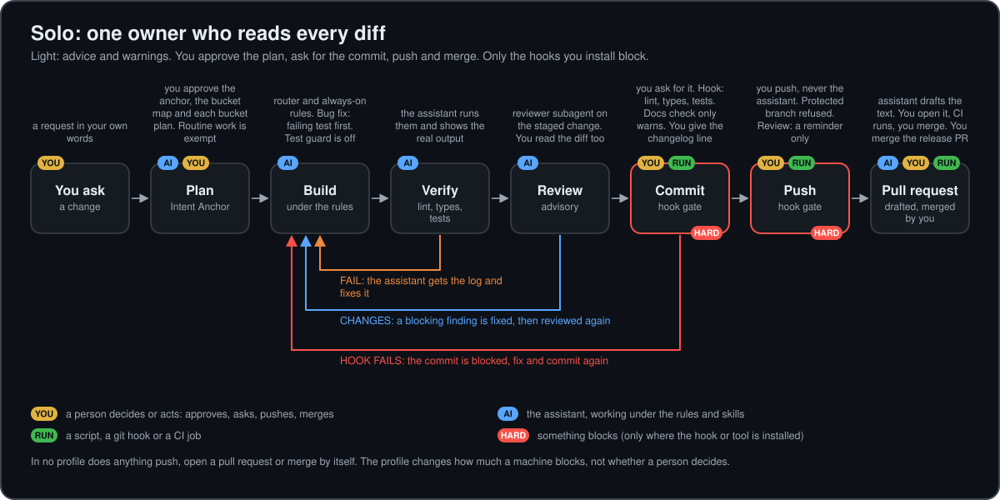
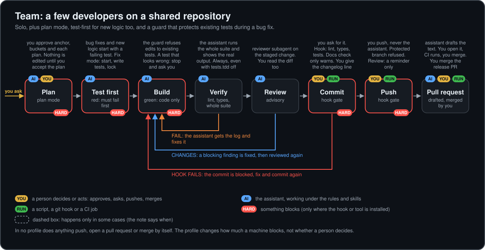
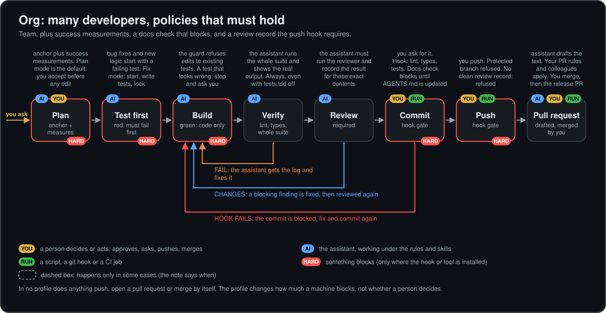
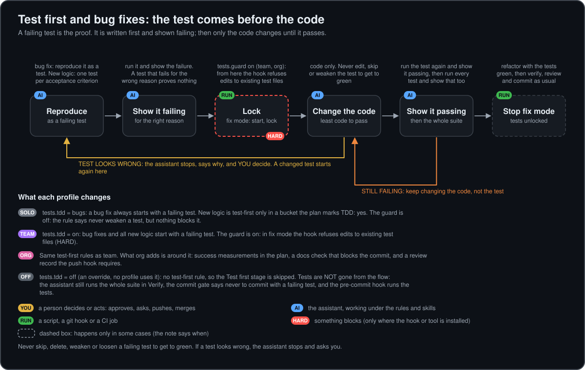
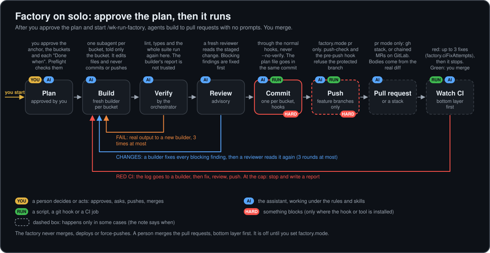
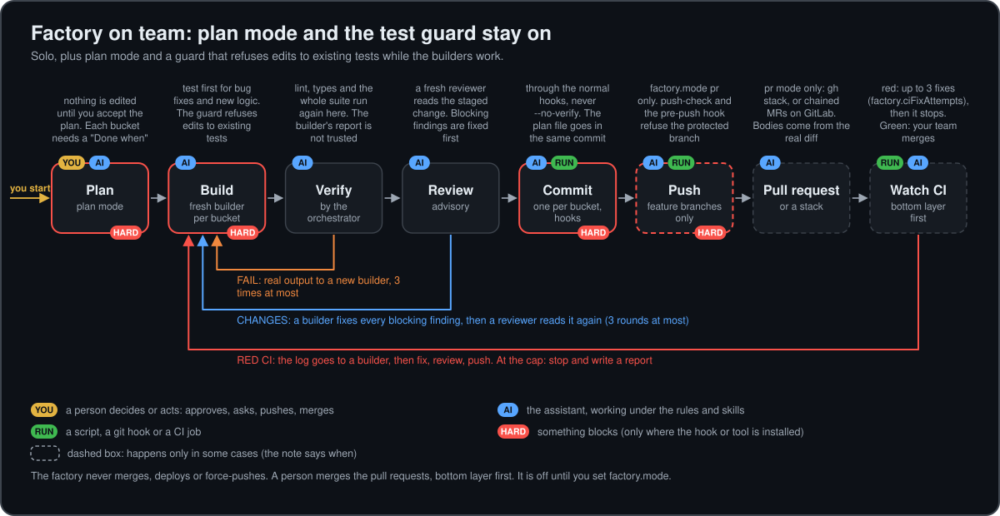
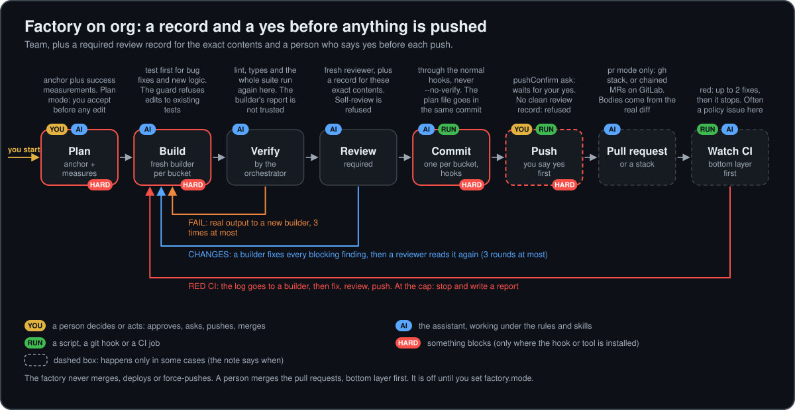
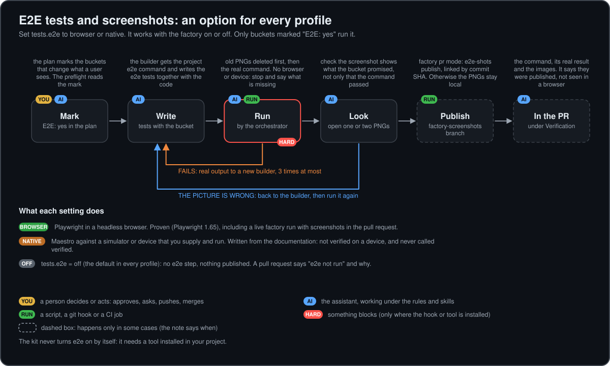

# Solo, team and org: the flows, the factory and the hard stops

Section 7 of the former README: what each profile turns on, the flow diagrams, the factory, end-to-end tests, and the hard stops. Back to the [README](../README.md).

## 7. Solo, team and org: what turns on and off

One file sets it: `.claude/workflow.json`.

```json
{ "profile": "solo", "overrides": { "docs.check": "strict" } }
```

| Profile | For | In one line |
|---|---|---|
| `solo` (default) | One owner who reads every diff and approves every step | Light: advice and warnings; the Intent Anchor is agreed before non-trivial work; nothing blocks except the hooks you installed |
| `team` | A few developers on a shared repository | Adds the test-edit guard and test-first for new logic |
| `org` | Many developers, policies that must hold | Strict: the docs check blocks a commit, a clean review record is required to push, success measurements are recorded |

Pick the smallest profile that fits. A control that blocks costs time every day; turn one on when the risk it
removes is real, not because it exists. Skills are installed or not at setup; the profile changes how strictly
the workflow requires them.

### The flow in each profile: what is automated, what needs you

Every step is tagged with **who acts** and **how it is enforced**:

```text
   WHO ACTS    YOU   a person decides or acts: approves, asks, types, pushes, merges   <-- human in the loop
               AI    the assistant, working under the always-on rules and skills
               RUN   a script, a git hook or a CI job; no assistant and no person needed

   ENFORCED    soft  a rule or a warning: the assistant follows it, nothing stops you
               HARD  something blocks (a hook exit code or a tool). It exists only where it is installed,
                     and a person can bypass it on purpose (--no-verify, REVIEW_MODE=off)
               off   not applied in this profile
```

The kit is a **human-in-the-loop** workflow. In no profile does anything push, open a pull request or merge by
itself. The profile changes how much is blocked by a machine, not whether a person decides.

#### Solo: one owner who reads every diff and approves every step


<details>
<summary>Text version of the solo flow</summary>

```text
   YOU   ask for a change
    |
    v
 1 PLAN     AI    gathers context, interviews you, drafts the Intent Anchor        planning.gates = anchor, soft
    |       YOU   approve the Intent Anchor, then the bucket map, then each bucket's plan
    |             (a tight, small, already-tested change is exempt; plan mode is not offered)
    v
 2 BUILD    AI    router picks the skill; the always-on rules shape the change                  soft
    |             a bug fix starts with a failing test; new logic is test-first only when a bucket says TDD: yes
    |       off   test-edit guard: nothing stops an edit to an existing test; the rule says never weaken one
    |       YOU   answer "proceed, adjust or stop?" after each bucket
    v
 3 VERIFY   AI    runs lint, types and tests, shows the real output, says what was not checked   soft
    v
 4 REVIEW   AI    starts the reviewer subagent on the staged change, fixes its blocking   review.mode = advisory, soft
    |             findings; a blocking finding sends it back to step 2, then review again
    v
 5 COMMIT   YOU   ask for the commit (assistants commit when asked)
    |       RUN   pre-commit hook, if you installed it: lint, types, tests                                  HARD
    |       RUN   docs-fresh check: source changed but AGENTS.md did not                   docs.check = warn, soft
    |       YOU   changelog: the bump type and one line, typed in the terminal (or the assistant supplies the
    |             two values when it commits for you)
    v
 6 PUSH     YOU   push. Assistants never push
    |       RUN   pre-push hook, if installed: refuses the protected branch you named                       HARD
    |       RUN   review gate: a reminder if this content has no clean review record                 soft (reminder)
    v
 7 PR       AI    pr-description drafts the text from the real diff
            YOU   open the pull request, let your own CI run, merge
            RUN   release workflow (optional): opens a release PR after the merge;  YOU merge it = the release
```

</details>

#### Team: a few developers on a shared repository


Same as solo, plus a real stop on planning, and a guard that protects tests during a bug fix.

<details>
<summary>Text version of the team flow</summary>

```text
   YOU   ask for a change
    |
    v
 1 PLAN     AI    interviews you, drafts the Intent Anchor                         planning.gates = anchor, soft
    |       YOU   approve the Intent Anchor, the bucket map, each bucket's plan
    |       RUN   plan mode, offered at setup: the terminal session cannot edit any file until
    |       YOU   accept the plan                                                                          HARD
    v
 2 BUILD    AI    router, always-on rules; NEW LOGIC IS TEST-FIRST                         tests.tdd = on, soft
    |
    |       a BUG FIX goes through fix mode (tests.guard = on):
    |          AI    writes a test that reproduces the bug and shows it FAILING for the right reason
    |          AI    node scripts/test-edit-guard.mjs start, then lock (the assistant starts fix mode)
    |          RUN   from here an Edit, Write or MultiEdit on an existing test file is refused               HARD
    |          AI    changes the code only; runs the test, then the whole suite; then stop
    |
    |       YOU   answer "proceed, adjust or stop?" after each bucket
    v
 3 VERIFY   AI    lint, types, tests, real output                                                       soft
    v
 4 REVIEW   AI    reviewer subagent on the staged change; fixes blocking findings            review.mode = advisory
    v
 5 COMMIT   YOU   ask for the commit; type the changelog bump and line (or the assistant supplies them)
    |       RUN   pre-commit hook: lint, types, tests                                                     HARD
    |       RUN   docs-fresh check                                                           docs.check = warn, soft
    v
 6 PUSH     YOU   push
    |       RUN   pre-push hook: protected branch refused                                                  HARD
    |       RUN   review gate: reminder if there is no clean record                                  soft (reminder)
    v
 7 PR       AI    pr-description drafts the text      YOU  open the PR, CI, merge      RUN  release PR (optional)
```

</details>

#### Org: many developers, policies that must hold


Same as team, plus success measurements, and three more things that block: the docs check, the review record at
push, and plan mode as the default.

<details>
<summary>Text version of the org flow</summary>

```text
   YOU   ask for a change
    |
    v
 1 PLAN     AI    interviews you; drafts the Intent Anchor AND the success measurements    planning.gates = full
    |             (metric, baseline -> target, how it is measured)
    |       YOU   approve the anchor, the bucket map, each bucket's plan
    |       RUN   plan mode is the session default: no file edit until
    |       YOU   accept the plan                                                                          HARD
    v
 2 BUILD    AI    router, always-on rules; new logic test-first                            tests.tdd = on, soft
    |             bug fix in fix mode: failing test first, then the guard protects existing tests          HARD
    |       YOU   answer "proceed, adjust or stop?" after each bucket
    v
 3 VERIFY   AI    lint, types, tests, real output                                                       soft
    v
 4 REVIEW   AI    MUST run the reviewer subagent on the staged change, fix its blocking    review.mode = required
    |             findings, and record the result (.claude/reviews/<tree>.md); changed content needs a new record
    v
 5 COMMIT   YOU   ask for the commit; changelog bump and line
    |       RUN   pre-commit hook: lint, types, tests                                                     HARD
    |       RUN   docs-fresh check: source changed but AGENTS.md did not                    docs.check = strict, HARD
    |             the commit is blocked until the overview is part of it
    v
 6 PUSH     YOU   push
    |       RUN   pre-push hook: protected branch refused                                                  HARD
    |       RUN   review gate: refused when the content has no clean record, or the record has blocking
    |             findings                                                                                 HARD
    v
 7 PR       AI    pr-description drafts the text      YOU  open the PR, CI, review by your colleagues, merge
            RUN   release PR (optional)               YOU  merge it
```

</details>

Two limits to keep in mind in `org`. The review record is an attestation: the assistant that wrote the change can
write it, so the push check is a reminder with teeth, not independent proof. And a second person reading the pull
request, branch protection and required CI are your project's own settings; the kit neither reads nor sets them.

#### Test first and bug fixes: the test comes before the code

In the diagrams above, **Test first** is a stage of its own, before **Build**: the failing test is the proof, so
it is written and shown failing before any code is changed. This diagram zooms in on that part and on what
each profile changes (the rule is [`rules/test-discipline.md`](../rules/test-discipline.md); the policy is in
[`docs/test-discipline.md`](test-discipline.md)).

Turning test-first off (`tests.tdd = off`) removes the **Test first** stage, not the tests: the assistant still
runs the whole suite in **Verify**, the commit gate still says never to commit with a failing test, and the
pre-commit hook still runs the tests. Only the rule "write the failing test first" goes away.



#### Where a person is in the loop

| Moment | solo | team | org | What the person does |
|---|---|---|---|---|
| Approve the Intent Anchor, the bucket map and each bucket plan | yes | yes | yes (plus the success measurements) | **Approves** before any non-trivial code |
| Accept the plan before any edit (plan mode) | no | yes | yes | **Accepts**; a real stop in the terminal |
| "Proceed, adjust or stop?" after each bucket | yes | yes | yes | **Decides** |
| Read the change | you read the diff; the reviewer is advisory | same | the reviewer must run and record; you still decide | **Judges** |
| A test that looks wrong while fixing a bug | yes | yes | yes | **Decides**: the assistant stops, says why and asks; it never edits, skips or weakens the test on its own |
| Ask for the commit | yes | yes | yes | **Asks**; assistants commit only when asked |
| Changelog bump and one-line entry | yes | yes | yes | **Types** it (or the assistant supplies it when it commits for you) |
| Refresh the overview (`write-project-overview`) | yes | yes | yes | **Approves line by line**; only approved lines change |
| Design sync (`figma-sync`, if used) | yes | yes | yes | **Approves** the plan before anything is drawn or written |
| Approve the setup preview (`apply --dry-run`) | yes | yes | yes | **Says yes** before anything is installed |
| Push | yes | yes | yes | **Pushes**; assistants never push (unless you started the factory in `pr` mode: then feature branches only, and in org it asks for a yes first) |
| Open the pull request, merge | yes | yes | yes | **Merges** always; the kit drafts the text, and the factory (if you started it) opens the pull requests |
| Start the factory (`/wk-run-factory`) | optional | optional | optional | **Starts it by hand**; that is the approval to carry the approved plan through |
| Merge the release PR (if the release workflow is installed) | yes | yes | yes | **Merges**; that is the release |

What runs without a person, in every profile: the always-on rules and the router, the verification and
test-discipline rules, the reviewer subagent when the assistant starts it, the commit and push hooks, the
test-edit guard, the config checks, and the release workflow's opening of a release PR.

The controls, as a table:

| Step or piece | solo | team | org |
|---|---|---|---|
| Planning before code (`planning.gates`) | `anchor`: soft rule | `anchor`: soft rule | `full`: soft rule + measurements |
| Always-on rules (readable code, tidy repo, docs fresh, verification) | on | on | on |
| Test-edit guard in fix mode (`tests.guard`) | off | on | on |
| Bug fix starts with a failing test | rule | rule | rule |
| New logic test-first (`tests.tdd`) | `bugs`: only when a bucket says `TDD: yes` | `on`: rule | `on`: rule |
| Reviewer before a commit (`review.mode`) | `advisory` | `advisory` | `required` |
| Push blocked without a clean review record | no (reminder) | no (reminder) | yes |
| Docs-fresh check at commit (`docs.check`) | `warn` | `warn` | `strict` (blocks) |
| Doc-size warning (`docs.sizeWarnChars`) | 40,000 characters | 40,000 | 40,000 |
| Static checks: skill lint, `@` imports (`static.checks`) | on | on | on |
| Checks that run `claude -p` (`claude.runChecks`) | off (opt-in) | off (opt-in) | off (opt-in) |
| Plan mode as the session default | not offered | offered | offered |
| Factory (`factory.mode`) | `off` | `off` | `off` (opt in; org asks before each push and allows 2 CI fixes) |
| End-to-end tests (`tests.e2e`) | `off` | `off` | `off` (opt in: `browser` or `native`) |
| Commit hook, push hook, changelog | your install choice, the same in every profile | | |

### The factory, an optional layer

The profiles above end with "you push". The **factory** is an opt-in layer on top of any profile for people who want
the assistants to carry an approved plan further. **It is off in every profile** (`factory.mode: off`). You turn it
on, approve a plan, and start it by hand with `/wk-run-factory`. Then, without further prompts:

1. a fresh **builder** subagent builds each bucket of the plan, and never commits or pushes;
2. the orchestrator runs lint, types and the tests itself and does not trust the builder's report;
3. a fresh **reviewer** subagent reads the change (blocking findings go back to a builder, three rounds at most);
4. one commit per bucket, through the normal hooks;
5. in `factory.mode: pr`: `push-check`, then it pushes **feature branches only**, opens the pull request or a **stack**
   of them (`gh stack` on GitHub, chained merge requests on GitLab, one PR per bucket where neither works), and watches
   CI, bottom layer first. A red layer gets a capped number of fixes (`factory.ciFixAttempts`: 3, org 2), then it stops
   and writes a report. In `local` mode it writes the PR text and stops before any push.

**It never merges, never deploys, never force-pushes, and the pre-push hook still refuses the protected branch.**
A person merges, bottom layer first.

What changes per profile:

| | solo | team | org |
|---|---|---|---|
| Plan | you approve it | plan mode: no edit until you accept | plan mode, plus success measurements |
| Builders | fresh subagent per bucket | same, and the test guard refuses edits to existing tests | same as team |
| Review | `advisory` | `advisory` | `required`: a recorded result for the exact contents; a self-review does not count |
| Push (`pr` mode) | automatic (`pushConfirm: auto`) | automatic | asks you for a clear yes first (`pushConfirm: ask`) |
| CI fix attempts | 3 | 3 | 2 |







**What is proven, and what is not** (details and the exact list: [`docs/factory.md`](factory.md),
[`docs/factory-rehearsal.md`](factory-rehearsal.md)):

| Proven in a live run | Not proven |
|---|---|
| GitHub: a two-bucket stack with `gh stack`, a red lower layer, a fix, a restack, green CI. Chained PRs opened with plain `git push` and `gh pr create` (the route without `gh stack`), with CI, a fix and a restack | `prLayout: single` with `factory.mode: local` on a small project: one branch, one commit per bucket, nothing pushed, the PR text written | A `single` layout in `pr` mode |
| GitLab (gitlab.com): chained merge requests, a red bottom layer, a fix, a no-force restack, green | A self-managed GitLab server |
| A real CI pipeline with a fixable and an unfixable red check (and a one-line documentation fix made by the orchestrator under `factory.fastFix: docs`, approved by `fast-check`, with no builder or reviewer): found, read, fixed by a fresh builder, re-reviewed, restacked by merge with no force push; a stop with a written report for a check that needs an outside approval (twice); the counter's stop (`ciFixAttempts: 0`, report-only) with a report; a resume in a fresh session that rebuilds nothing and watches CI | The attempt counter's stop with a positive cap, reached after real fix attempts in a live loop (the live stop was with `ciFixAttempts: 0`; the earlier stops were the agent's judgment) |
| `org` profile, end to end on a small project: `pushConfirm: ask` stopped before the first push, a `[bug]` from the reviewer was fixed and re-reviewed before any PR, a recorded review for every pushed tip (a CI fix and a merge commit included) passed the required pre-push gate, and the by-hand restack worked | `org` on a large project; a yes for each later push (the skill now asks, not yet run) |
| The kit's own tests and install smoke test on Ubuntu, macOS and Windows with Node 18 and 22 (CI, all six jobs green); an install matrix from the packed tarball, 12 combinations (Windows only) | The matrix on macOS and Linux (it is not part of CI yet) |
| Browser e2e with screenshots in the PR body | Native e2e; any tool other than Claude Code (Cursor, Codex, OpenCode, Cline were written from their documentation and not run) |

Outside Claude Code the factory runs as a **single agent**: the same steps as separate passes, with no fresh context
and no independent reader. Its review is a labeled self-review, which the gate does not count under
`review.mode: required`, so the push stops and asks you. Each subagent also carries a fixed prompt prefix that is
re-read every turn, so even a small change costs real tokens; the measurements and what was done about them are in
[`docs/factory-trial.md`](factory-trial.md).

#### End-to-end tests and screenshots

`tests.e2e` is an option for **every profile, with the factory on or off**: `browser` (Playwright in a headless
browser) or `native` (**experimental**: Maestro against a simulator or device you supply). It is `off` by default because it needs a
tool installed in your project; the kit never turns it on. Only buckets the plan marks `E2E: yes` run it. In the
factory, the screenshots go to a separate `factory-screenshots` branch and appear in the PR body under Verification,
with a plain statement that the images were published, not seen in a browser. Browser e2e is proven; native is
written from the tool's documentation and **not verified on a device**.



### Turning pieces on and off: what changes in the flow

The profile sets how strictly the workflow uses a piece. Whether a piece is **installed at all** is your choice at
setup (and you can run the setup again). Each row says what the flow looks like with the piece on and off.

| Piece (how it is turned off) | With it on | With it off, the flow becomes | Who is affected |
|---|---|---|---|
| **Planner**: `planning.gates = off`, or `goal-first-planner` not installed | Non-trivial work waits for an approved Intent Anchor; a checkpoint after each bucket | The assistant starts from your request. No written goal, no checkpoints: you steer by reading the diff | You lose the approval points of step 1 |
| **Plan mode default**: not chosen at setup (solo) | The terminal session cannot edit until you accept a plan; the only hard stop on planning | Planning is a soft rule the assistant follows. Not read by the VS Code extension in any case | You accept less, the assistant is trusted more |
| **Router**: `workspace-router` not installed | The assistant reads the skill that fits before it starts | It may work from memory; a skill is used only when you call it or its description matches | You get less consistent use of the other skills |
| **Test-edit guard**: `tests.guard = off` | During a bug fix an edit to an existing test file is refused | The rule still says never weaken a test, but nothing stops it; you would notice in the diff | Review carries the load |
| **Test-first**: `tests.tdd` = `off` / `bugs` / `on` | `on`: new logic too is test-first | `bugs`: only bug fixes, and buckets marked `TDD: yes`. `off`: no rule | You decide what counts as proof |
| **Reviewer and review gate**: `review.mode` | `advisory`: the assistant reviews before every commit; the push hook only reminds. `required`: the push hook refuses without a clean record | `off`: a review happens only when you ask, and the push hook says nothing. **Not installed at all**: no reviewer, no `REVIEW.md`, no record; step 4 disappears and you are the only reader | You |
| **Commit hook**: not installed | Lint, types and tests run on every commit and block it when they fail | Nothing stops a commit with failing checks; the commit-gate rule tells the assistant to run them (soft). No docs check, no changelog prompt | You |
| **Docs-fresh check**: `docs.check` = `off` / `warn` / `strict` | `strict` blocks a commit that changes source without the overview; `warn` prints a message | `off`: silent. The docs-fresh rule still asks the assistant to update the overview | You |
| **Changelog**: `changelog-bump` not installed | Every commit that changes behaviour carries a bump type and an entry | No changelog, no version bump; the release workflow cannot run (it needs this skill) | You |
| **Release workflow**: not installed | After a merge to the protected branch a release PR is opened; merging it is the release | You bump versions and the changelog by hand | You |
| **Push hook**: not installed | The protected branch is refused; the review gate runs at push | Nothing blocks a push to the protected branch except the commit-gate rule (soft). GitHub branch protection is outside the kit | You |
| **`pr-description`**: not installed | The pull request text is drafted from the real diff and `PLAN.md` | You write it | You |
| **Overview skill**: `write-project-overview` not installed | `AGENTS.md` is written from the code and refreshed with your line-by-line approval | You keep `AGENTS.md` by hand; the docs-fresh check still compares it against changes | You |
| **Design sync**: `figma-sync` and `ui-change-flagging` not installed (off by default) | UI changes are logged turn by turn; before the commit the assistant shows its plan and asks before it draws or writes anything | No design step | You approve less |
| **Harsh review**: `ultra-code-quality-review` | Runs only when you call it; it is not part of the gate and leaves no record | Nothing; the normal review is unaffected | You |
| **Claude-powered checks**: `claude.runChecks` = `false` (default) | You can run the two checks that call `claude -p`; they use your Claude usage and never run from a hook or CI | They cannot run | You start them |

### Changing it

```text
   edit .claude/workflow.json   "profile": "solo" | "team" | "org"
   one control               "overrides": { "docs.check": "strict" }
   one command only          DOCS_CHECK=strict git commit ...      (each control has an environment variable)
   whole profile, one command WORKFLOW_PROFILE=org <command>
   see the result            node scripts/workflow-config.mjs      (prints every control and where it came from)
```

Precedence: environment variable, then `overrides`, then the profile default. A missing or broken file means
`solo`, with a warning. Full table of the controls, with the reason for each profile's value:
[`docs/workflow-profiles.md`](workflow-profiles.md).

### Hard stops, in one place

| Stop | When it blocks |
|---|---|
| Commit hook: lint, type check, tests | Always, if you installed the hook and a check fails |
| Docs-fresh check | `docs.check` is `strict` (org by default) |
| Test-edit guard | `tests.guard` is `on` (team and org), the PreToolUse entry is in `.claude/settings.json`, and fix mode was started with `start`; it blocks edits made by Claude (Edit, Write, MultiEdit) |
| Pre-push: protected branch | Always, if you installed the push hook and named a protected branch at setup |
| Pre-push: review gate | `review.mode` is `required` (org by default) |
| Factory `push-check` | `factory.mode` is `pr`: anything but a feature branch is refused; a stop is written to `.claude/factory/report.md` |
| Factory push confirmation | `factory.pushConfirm` is `ask` (org by default), or a single-agent run under `review.mode: required` |

Everything else is a rule or a warning. A hook that cannot run (no git, a crash, no `node`) allows the action
and says so; a broken profile file falls back to `solo` with a warning.
